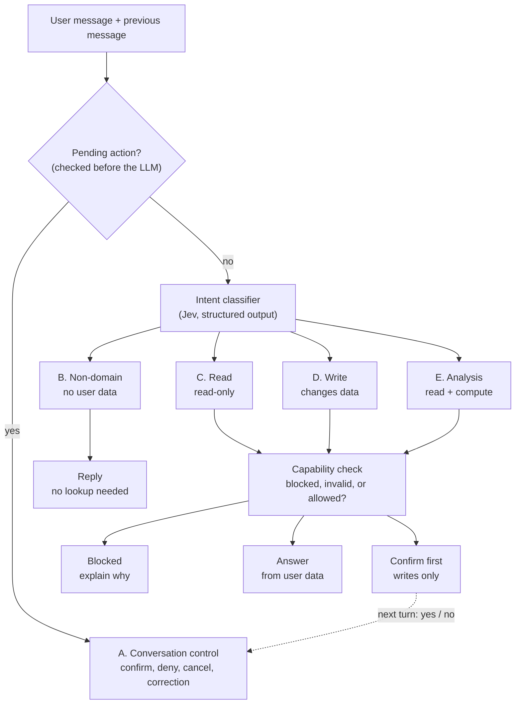
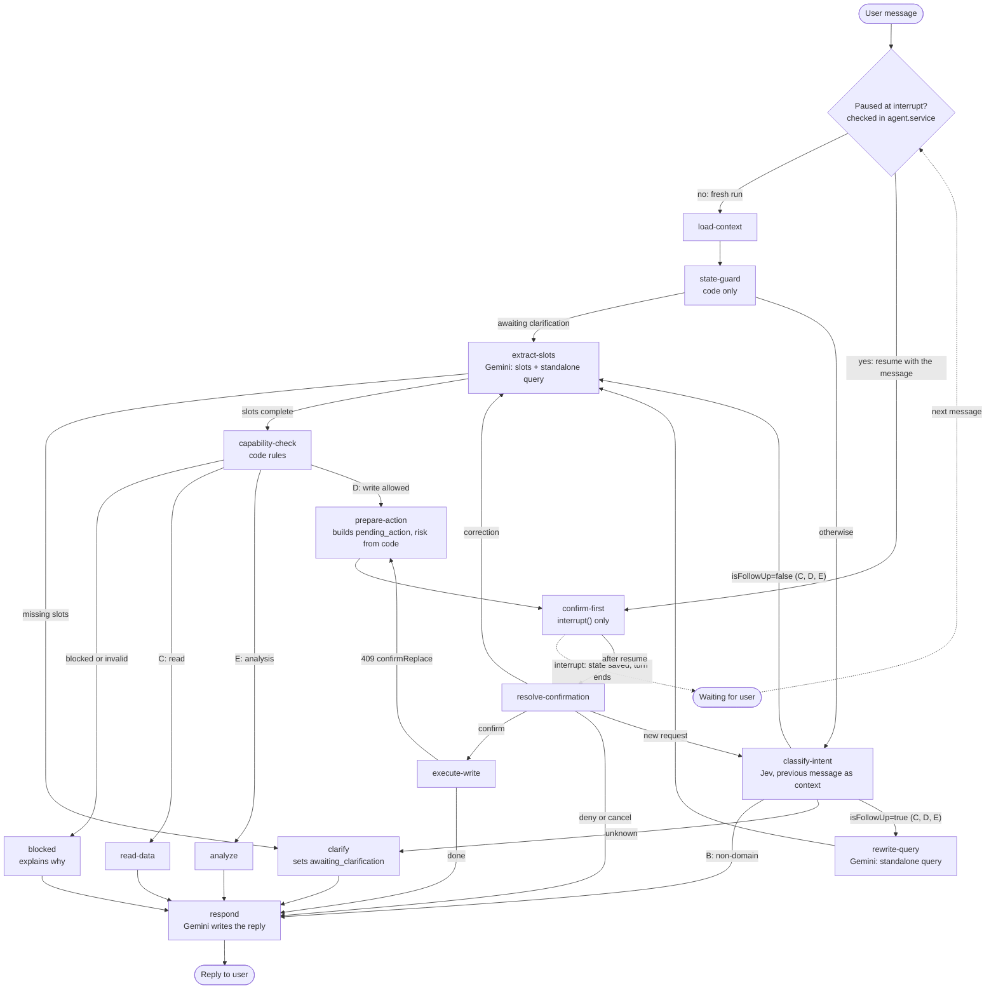

# Savvist Chat Assistant

Architecture and implementation status of the AI chat assistant module (`apps/savvist-backend/src/app/modules/chat`).

**Contents**

1. [Overview](#1-overview)
2. [Directory Structure](#2-directory-structure)
3. [Workflow](#3-workflow)
4. [Design Decisions](#4-design-decisions)
5. [Node Reference](#5-node-reference)
6. [Open Points](#6-open-points)

---

## 1. Overview

The assistant is a **LangGraph state machine** inside **NestJS**.

- **Jev (TypeSafe AI)** classifies intent.
- **Google Gemini** extracts slots, rewrites follow-up queries, and writes replies.
- **Deterministic code** handles policy, routing, risk and all numbers.
- **MongoDB checkpoints** persist state, and writes need an explicit human confirmation.

It is a daily-money assistant for one user: balances, spending, expenses, wishlist and reminders. Large purchases, loans, investing, and tax or legal advice are out of scope ([4.6](#46-boundaries-and-legal-safety)).

---

## 2. Directory Structure

Most files have a `.spec.ts` sibling, omitted here. Files marked **stub** are empty or placeholders.

```
chat/
|-- chat.module.ts                  # Imports conversations, messages and agent
|-- conversations/                  # Conversation CRUD (controller, service, DTOs, schema)
|-- messages/                       # Message persistence and streaming (controller, service, DTOs, schema)
\-- agent/
    |-- agent.module.ts             # Wires graph, classifiers, LLM services, tools, observability
    |-- agent.service.ts            # Entry point: pause detection, compound-query splitting, per-thread queue
    |
    |-- graph/
    |   |-- agent.graph.ts          # StateGraph builder: 14 nodes, edges, checkpointer
    |   |-- agent.state.ts          # State schema (Annotation.Root)
    |   |-- agent.routers.ts        # Conditional routing functions
    |   |-- pending-action.schema.ts# Zod schema for PendingAction and ConflictItem
    |   |-- turn-context.ts         # TurnContext, UserProfile, todayIn(), isValidTimeZone()
    |   |-- studio.ts               # LangGraph Studio dev entrypoint
    |   \-- nodes/
    |       |-- load-context        # Profile, time zone, today, due-reminder count
    |       |-- state-guard         # Reset or preserve state between turns
    |       |-- classify-intent     # Jev intent classification
    |       |-- rewrite-query       # Gemini: follow-up -> standalone query
    |       |-- extract-slots       # Gemini: slot extraction
    |       |-- clarify             # Clarification questions
    |       |-- capability-check    # Policy rules
    |       |-- blocked             # Refusal reason
    |       |-- read-data           # Read tools / product search
    |       |-- analyze             # STUB: analysis intents
    |       |-- prepare-action      # Builds pending_action
    |       |-- confirm-first       # interrupt() only
    |       |-- resolve-confirmation# Interprets the user's reply to a pending action
    |       |-- execute-write       # Runs approved writes
    |       \-- respond             # Gemini reply (every path ends here)
    |
    |-- intent/                     # Intent taxonomy, types, risk tiers, score-to-result
    |   \-- classifiers/            # jev.client.ts, jev.classifier.ts, jev.questions.ts; keyword.classifier.ts (stub)
    |-- llm/                        # gemini.service, slot-extractor, query-rewriter, reply-writer, prompts/
    |-- capabilities/               # CapabilityCheckService + rules/ (7 rules)
    |-- tools/                      # read.tool, write.tool, product-search.service, date-utils, data-tools
    |                               # memory.tool.ts and tool-registry.ts are stubs
    |-- observability/              # Per-turn logging (writes logs.json, gitignored)
    |-- eval/                       # Offline eval harness (all stubs)
    \-- persistence/
        \-- mongo-checkpointer.provider.ts  # MongoDBSaver on Mongoose's native client
```

---

## 3. Workflow

### 3.1 Key decisions

- **No `undo_last`.** "Undo that" is a blocked request (`unsupported_feature`).
- **Follow-ups go through `rewrite-query`.** Jev sets `isFollowUp=true`, and `routeAfterClassify` sends the message to `rewrite-query` before `extract-slots`. The graph structure prevents re-entering `rewrite-query`, so no extra flag is needed.
- **`confirm-first` only calls `interrupt()`.** On resume LangGraph restarts the paused node from its beginning, so `pending_action` is built in a separate `prepare-action` node beforehand.
- **No extra nodes for newer features.** Reminders, wishlist swap, safe-to-spend, spending review and memory use the existing path.
- **Compound messages are split in `agent.service`** before the graph runs ([4.2](#42-pause-detection-and-multi-intent-messages)).

### 3.2 High-level routing



### 3.3 Detailed LangGraph workflow



The three loops worth knowing:

- **Correction:** `resolve-confirmation` -> `extract-slots`, so changed values pass the capability check again.
- **New request:** `resolve-confirmation` -> `classify-intent`, when the user ignores the pending question.
- **409 conflict:** `execute-write` -> `prepare-action`, for a second confirmation (replace or swap).

---

## 4. Design Decisions

### 4.1 State definition

The graph state in `agent.state.ts` uses `Annotation.Root`, the style the LangGraph JS docs recommend. The state is mostly plain fields and does not need schema-first features. `StateSchema` or Zod would also work; revisit only if you want type and runtime validation from one definition (check the installed `@langchain/langgraph` and Zod versions first).

| Field | Type | Description |
|---|---|---|
| `messages` | `BaseMessage[]` | Conversation history (`messagesStateReducer`) |
| `intentResult` | `IntentResult \| null` | Classification, including `capabilityCheck` and `isFollowUp` |
| `slots` | `any \| null` | Slots extracted by Gemini |
| `readResult` | `any \| null` | Data from `read-data`; cleared by `respond` |
| `writeResult` | `any \| null` | Result from `execute-write` |
| `pending_action` | `any \| null` | Action awaiting confirmation |
| `awaiting_clarification` | `string \| null` | The clarification question asked |
| `clarification_turns` | `number` | Turns within a clarification round |
| `context` | `TurnContext \| null` | userId, today, timeZone, etc. |
| `rewrittenQuery` | `string \| null` | Output of `rewrite-query` |
| `queued_queries` | `string[]` | Remaining sub-queries of a split compound message |

**`pending_action` validation.** It is saved to Mongo and read back on a later turn, possibly after a deploy. `resolve-confirmation` parses it with `PendingActionSchema.safeParse`; if parsing fails the action is cancelled, so a malformed or outdated action never reaches `execute-write`.

### 4.2 Pause detection and multi-intent messages

**Pause detection.** The `Entry` check is made in `agent.service` before the graph runs, not in a node.

- It reads the saved thread state with `getState(thread_id)`. The thread is paused when any task in the snapshot has a non-empty `interrupts` list. (`next` alone is not enough, because it can also be non-empty after a crash.)
- Fallback for versions without `interrupts` on tasks: treat the thread as paused when `next` contains `confirm-first`.

**Routing after the check**

| Situation | What happens |
|---|---|
| Paused, user confirms or denies | `jevClient.resolveConfirmationResponse()` runs first; the graph resumes with `Command({ resume: 'yes' \| 'no' })` |
| Paused, user corrects or asks something new | The raw user text is passed on resume |
| Paused, reply has a secondary request ("yes, and also show my expenses") | `queryRewriter.extractSecondaryQuery()` extracts it; it is queued and runs after the write resolves |
| Not paused, compound message | `queryRewriter.splitCompoundQueries()` splits it. The first sub-query runs with the rest in `queued_queries`; the rest run in parallel afterwards unless an interrupt occurred, and replies are joined |
| Not paused, single message | Fresh run with `{ messages: [new HumanMessage(text)] }` |

Batch operations ("set BDO 45k and GCredit 11k") are deliberately not split.

**Rules**

- **Ownership first.** Threads have no `userId`, so verify the conversation belongs to the user before reading state or invoking the graph.
- **Expiry.** `pending_action.expiresAt` is checked in `resolve-confirmation`; an expired action is cancelled.
- **Concurrency.** `agent.service` serializes turns per thread with a `Map<string, Promise>` queue.
- **Clarification is not an interrupt.** `awaiting_clarification` is ordinary state, handled by `state-guard`.
- **Needs real persistence.** Detection only works if checkpoints persist across requests, so test against the real `MongoDBSaver` ([4.3](#43-mongodb-checkpointer)).

### 4.3 MongoDB checkpointer

`MongoDBSaver` (`@langchain/langgraph-checkpoint-mongodb`) is set up in `mongo-checkpointer.provider.ts`.

- **Setup.** The constructor takes an options object with a required `client` (plus optional `dbName`, `checkpointCollectionName`, `checkpointWritesCollectionName`, `enableTimestamps`). Set `dbName` explicitly to the app's database, keep the default collections (`checkpoints`, `checkpoint_writes`), and call `saver.setup?.()` once at startup.
- **Reusing Mongoose.** The provider injects the Mongoose connection and uses `connection.getClient()`. Never close that client from the saver. If the `mongodb` driver versions differ, the `MongoClient` types may clash; run `npm ls mongodb` and align them. Fallback: open a second `MongoClient`.
- **State size.** A checkpoint is written at every super-step and must fit in one 16 MB document. Keep state small: IDs and arguments, not query results.
- **Retention.** `enableTimestamps` adds `upserted_at`; add a TTL index on it for both collections if you want automatic cleanup. TTL can age out an idle conversation's agent memory, but `messages` keeps the visible history.
- **Deleting a conversation.** `deleteThread(threadId)` removes a thread's checkpoints and writes. It cannot join the conversation-delete transaction, so make it idempotent and safe to retry.

**Tests to run before relying on it:** a restart simulation (pause is still detected and resume reaches `resolve-confirmation`), cross-user thread access is refused, and `deleteThread` leaves no documents behind.

### 4.4 prepare-action

A separate node between `capability-check` and `confirm-first`.

**Why separate**

- It runs once and a checkpoint is saved after it, so `pending_action` is stored before the pause.
- The 409 loop needs a node to return to that rebuilds `pending_action` with conflict details.
- `capability-check` stays a pure policy gate.
- Risk comes from `risk-tier.ts`, never from the model.

**What it does:** takes a write intent with complete slots that passed `capability-check` and outputs a Zod-validated `pending_action` (`tool`, `intent`, `risk`, `args`, `description`, `createdAt`, `expiresAt`). Values are plain and serializable. It makes no model calls. Expiry defaults to 10 minutes. On the 409 path it stores `ConflictItem[]` in `pending_action.conflict` and describes existing vs proposed balances.

**Edges:** `capability-check` -> `prepare-action` -> `confirm-first`; `execute-write` (409) -> `prepare-action`; a `correction` re-enters through `extract-slots` and `capability-check`.

### 4.5 What the assistant can do

Intent names are illustrative; the final names live in `intent.types.ts`.

| Capability | Group | Confirm first | Notes |
|---|---|---|---|
| Read balances, Total Fund, Actual Cash, Health, Growth, Today's Allowance, 30-day trend | C | no | Values come from `read.tool.ts`, never the model |
| Read expenses, wishlist, record logs, reminders, profile | C | no | Record logs are read-only |
| Search products | C | no | `search_products` -> `ProductSearchService` |
| Update base salary and employment status | D | yes | Unemployed forces salary 0; subject to `policy-flag.rule.ts` |
| Account entries: create, rename, delete | D | yes | Type is locked once records exist; delete archives if records exist |
| Entry records: save, change or delete a day's balance | D | yes, and again before replacing a balance | No future days |
| Expenses: create, edit, delete | D | yes | |
| Wishlist: create, edit, delete, mark purchased, undo purchase | D | yes | |
| Wishlist: swap priority | D | yes (one confirmation) | [4.8](#48-wishlist-priority-swap) |
| Reminders: create, edit, complete, delete | D | yes | [4.7](#47-reminders-and-relative-dates) |
| Memory: list, save, forget | C and D | save and forget | [4.10](#410-agent-memory) |
| Affordability, safe spending range, when-available, what-if | E | no | [4.9](#49-safe-to-spend-and-spending-review) |
| Spending review ("am I spending too much?") | E | no | Conversational only |
| Greetings, "what can you do?" | B | no | Handled in `respond` via `smalltalk()` |

**Risk tiers** (`risk-tier.ts`):

| Tier | Intents |
|---|---|
| low | `manage_memory`, `manage_reminder` |
| medium | `update_base_salary`, `manage_account_entry`, `manage_expense`, `manage_wishlist`, `swap_wishlist_priority` |
| high | `manage_entry_record` |

### 4.6 Boundaries and legal safety

The `blocked` node explains the reason in one or two sentences and says what the assistant can do instead.

| Request | Blocked by |
|---|---|
| Property, vehicles, loans, business funding, investing, crypto, stocks, insurance | `unsupported-feature.rule.ts` |
| Tax, legal or investment advice | `unsupported-feature.rule.ts` (Jev `prohibited_advice_or_topic` Noul >= 0.7) |
| Pressuring or taking legal action against a borrower, hiding a debt | `unsupported-feature.rule.ts` |
| Affordability or what-if for a very large amount | `large-amount.rule.ts` |
| "Undo that" / "revert that" | `unsupported-feature.rule.ts` |
| A balance dated in the future | `future-data.rule.ts` |
| Changing an account's type after it has records | `account-type-lock.rule.ts` |
| Editing or deleting record logs | `read-only-data.rule.ts` |
| Renaming or deleting a conversation, changing the time zone | `unsupported-feature.rule.ts` |

- **Large amounts.** Blocks analysis intents above `LARGE_AMOUNT_MULTIPLE * netIncome` (placeholder value 6, from `ConfigService`). It does not block recording data. Skipped if net income is 0.
- **Semantic policy.** `unsupported-feature.rule.ts` calls `jevClient.checkSemanticPolicy()` as an async gate. It fails safe: on error it returns `{ isProhibited: false }`.
- **Estimates, not advice.** Every analysis answer says it is an estimate from the user's own entries; `reply-writer.ts` adds that line.
- **Numbers come from code.** Gemini writes from a result object and never calculates a figure.
- **Stale data.** If balances are older than `STALE_DAYS`, the answer says so first.
- **Other people's data.** Only a first name or label is stored for a borrower or payer, with no contact details.

### 4.7 Reminders and relative dates

Reminders use the normal write path.

- **Kinds:** `collect_debt` ("someone borrowed X"), `expected_income`, and `custom`.
- **Dates are resolved in code.** Gemini returns an exact date or a structured phrase (unit, number, or "next month"). Vague phrases ("soon") go to `clarify`.
- **Past dates** are rejected by `reminder-date.rule.ts`; today is allowed. (This is the reverse of `future-data.rule.ts` for balances.)
- **Confirmation shows the exact date**, e.g. "Remind you on 2026-12-04 to ask Juan for 2000?".
- **Reminders never move money.** They are never counted in balances or the allowance.
- **In-app delivery only.** `load-context` stores `dueReminderCount`, `respond` adds one line on the first message of a new conversation, and `read-data` answers "what reminders do I have". No push or email.

### 4.8 Wishlist priority swap

- Intent `swap_wishlist_priority`. The user names two items or says "make X the priority item"; ambiguous names go to `clarify`.
- Only one pending item can hold `priority`. If it is taken, `execute-write` gets a 409 naming the holder and loops to `prepare-action`, which builds a swap: the target takes `priority`, the holder takes the target's old level.
- It is one `pending_action` (`tool: swapWishlistPriority`) showing both items before and after. One confirmation, and both changes apply in one transaction or neither does.
- Undoing a purchase into a taken `priority` slot uses the same 409 and swap.

### 4.9 Safe-to-spend and spending review

> [!WARNING]
> `analyze.node.ts` is a stub that returns `{}`, and the `analysis/` directory does not exist yet. The routing to `analyze` works; the computation does not.

**Safe-to-spend** (planned in `analysis/safe-to-spend.ts`)

- `read-data` fetches the inputs (base salary, payday dates, Actual Cash, Total Fund, expenses, latest balance day). `analyze` calls the function. Gemini only words the reply.
- Result is a small plain object: verdict (`safe`, `tight`, `not_safe`), the allowance before and after, the safe range or earliest payday, assumptions, and a stale flag.
- Intents: `check_affordability` (now), `check_spending_range` (N days), `estimate_when_available`. "Next month" is evaluated at next month's first payday.
- The amount comes from a wishlist item or a number the user gives.

**Spending review** ("am I spending too much?")

- Intent `spending_review`, with a `spending_review` state field holding the questions asked and answers given.
- `clarify` asks one question per turn (food, transport, subscriptions, groceries, leisure, etc.); answered questions are skipped.
- `MAX_REVIEW_QUESTIONS = 5`. After the last answer, or when the user stops answering, `analyze` runs with what it has and says what was missing. The answers become a daily figure compared with Today's Allowance.
- Conversational only: answers are not written to any collection.

### 4.10 Agent memory

> [!WARNING]
> `memory.tool.ts` is an empty stub. Agent memory is not functional yet.

Planned design:

- `memory.tool.ts` offers `listMemory`, `saveMemory`, `forgetMemory` over `agentMemories`.
- `load-context` reads up to 50 memories per turn and passes them to prompts as quoted data, never as instructions. They are not kept in graph state.
- Save and forget go through the normal confirm turn at the low risk tier. Nothing is saved automatically.
- Code validates a save before `prepare-action`: key format, value of at most 300 characters, and nothing that looks like a password or a long digit string.
- Data that already exists in collections (balances, salary, expenses) is never saved as memory.

### 4.11 Observability

`ObservabilityService` keeps a per-turn log of every node, LLM call, tool call and the final response.

- `agent.service.run()` calls `reset()` and `setUserMessage(text)` at the start of each turn.
- Nodes call `setExecutedNode(name)`; LLM and tool calls are logged with `setLLMCall`, `setToolCall` and `setLLMToolCall`.
- `setResponse(reply)` writes the entry to `observability/logs.json`; the previous session is kept in `prev-logs.json`. `setLogFilePath()` overrides the path in tests.

---

## 5. Node Reference

Nodes are listed in execution order. Each is in `graph/nodes/<name>.node.ts`.

### `load-context`

Runs first on every fresh turn. Resolves `userId`, fetches the profile (locale, time zone, display name) from `UserContextProvider`, computes `today` in the user's time zone, and counts due reminders. Stores the result as `state.context`.

**Improvements**
- Log profile-fetch errors (currently swallowed, silently falling back to `UTC`/`en`).
- Cache the profile briefly (about 60 s) to avoid re-fetching every turn.
- `ReminderCounter` has no concrete implementation wired in `agent.module.ts`, so the count is always 0.

### `state-guard`

Runs after `load-context` on fresh turns only. If `awaiting_clarification` is set and the turn count is under `maxClarificationTurns` (default 2), it keeps `intentResult` and `slots` so `extract-slots` can reuse them. Otherwise it clears `intentResult`, `slots`, `readResult` and `rewrittenQuery`. It never touches `pending_action`.

**Improvements**
- A limit of 2 may be too tight for wishlist and expense creation; consider 3 or a per-group setting.
- If the user changes topic mid-clarification, stale `intentResult` and `slots` are kept. Add an "answer or new topic?" check.
- `applyStateGuards` in `classify-intent` is a pass-through; real guards (e.g. `confirm` with no pending action) are still to be written.

### `classify-intent`

Sends the latest user message and the previous assistant reply to Jev. `scoreToResult` applies `minConfidence` and `minMargin`; if neither is met the result is `unknown`. Writes `IntentResult` (with `isFollowUp` and `secondary`) to state. `routeAfterClassify` then sends it to `rewrite-query`, `respond`, `clarify` or `extract-slots`.

**Improvements**
- The keyword classifier fallback exists as a stub but is never called when Jev fails.
- Only the primary intent is used by `capability-check` and `extract-slots`, so a secondary write intent is silently dropped.
- `previousAssistantMessage` may be a clarification question; consider skipping those.

### `rewrite-query`

Only for `isFollowUp=true`. Sends the last 6 messages and the elliptical query to `QueryRewriter.rewrite()` (Gemini) to get a standalone question ("What about last month?" -> "What were my expenses in October 2026?"). Stored in `state.rewrittenQuery`; falls back to the raw message if there is no history.

**Improvements**
- The fixed 6-message window loses older context; consider a summary or named entities.
- Sanity-check the rewrite and fall back to the original if it looks wrong.
- The rewrite is not reflected in `messages`, so clarifications show the original ambiguous text.

### `extract-slots`

Sends the effective message (`rewrittenQuery` for follow-ups, else the last user message) plus up to 6 prior messages to `SlotExtractor.extract()`. If `slots.incomplete` is true the router goes to `clarify`; otherwise it clears `awaiting_clarification`. Also re-entered on the correction path.

**Improvements**
- `slots` is typed `any` with no runtime validation. Parse with the Zod `SlotSchema` and set `incomplete = true` on failure.
- Normalize dates once here instead of again in `prepare-action` and `read-data`.
- Merge new extraction results over the previous `state.slots` instead of replacing them, so a short clarification answer ("the 15th") doesn't lose the name and amount.

### `clarify`

Reached for `unknown` intents or incomplete slots. Builds a targeted question from `intentResult` and `slots` (for example, asking only for the missing due day and listing known expenses), with a generic fallback. Stored in `state.awaiting_clarification`. Dedicated branches exist for `manage_entry_record`, `manage_expense`, `manage_wishlist` and `swap_wishlist_priority`.

**Improvements**
- Add branches for `manage_reminder`, `manage_memory`, `manage_account_entry` and `update_base_salary`; they currently get the generic fallback.
- Use a simple keyword hint to make the `unknown` fallback more relevant.
- Increment `clarification_turns` here rather than implicitly in `state-guard`.

### `capability-check`

A pure policy gate. Calls `CapabilityCheckService.check()`, which runs six synchronous rules (future-data, reminder-date, read-only-data, account-type-lock, large-amount, policy-flag) and then one async rule (`unsupported-feature`, which may call Jev's Noul check). The outcome is merged into `intentResult.capabilityCheck`. Blocked or invalid goes to `blocked`; otherwise to `read-data`, `analyze` or `prepare-action`.

**Improvements**
- `user.netIncome` is never populated, so `large-amount.rule.ts` is always skipped. Pass it from the profile or context.
- Short-circuit read intents to avoid a Jev Noul round-trip on every read.
- Strengthen the slot type so rules like `future-data` don't read `slots.date` as a raw string.

### `blocked`

Ensures a refusal reason always exists before `respond`. If a rule has not set one, it fills in "I can't help with that request. I can help with balances, expenses, wishlist items, and reminders." and guarantees `blocked: true`. Nothing to improve.

### `read-data`

Routes by intent to `ReadTool` or `ProductSearchService`: `read_balances`, `read_expenses`, `read_wishlist`, `read_record_logs`, `read_profile`, `search_products`. Secondary read intents run in parallel and are combined into a `multiIntent` result. `readResult` is consumed by `respond` via `ReplyWriter`.

**Improvements**
- `read_reminders` is declared but has no handler; add `ReadTool.getReminders()` and wire it.
- Use `Promise.allSettled` so one failing intent doesn't discard the others.
- `search_products` falls back to the raw last message; prefer `slots.standaloneQuery`.
- Remove the duplicate date normalization once `extract-slots` handles it.

### `analyze`

**Stub.** Returns `{}`. It is the landing point for `check_affordability`, `check_spending_range`, `estimate_when_available`, `spending_review` and `what_if_analysis`.

**To implement**
- `analysis/safe-to-spend.ts`, returning `{ verdict, allowance, allowanceAfter, safeRange, earliestPayday, assumptions, isStale }` ([4.9](#49-safe-to-spend-and-spending-review)).
- `resolve-relative-date.ts` to map phrases like "this weekend" or "next payday" to `YYYY-MM-DD` using `context.today` and `context.timeZone`.
- A question-loop driver for `spending_review` that picks the next unanswered question and hands off to `clarify`.
- A stale flag (computed in `load-context` or `read-data`) on every result.
- All numbers computed in TypeScript; the reply prompt must forbid Gemini from doing arithmetic.

### `prepare-action`

Builds the `PendingAction` shown for confirmation. Handles `update_base_salary`, `manage_expense`, `manage_wishlist` (create, update, delete, purchase), `swap_wishlist_priority` and `manage_entry_record` (the default). For updates and deletes it resolves the existing record by name via `WriteTool.resolveExpense()` / `resolveWishlistItem()` so the message can show current vs proposed values. On a 409 it rebuilds with `conflict` set. Results are Zod-validated, expire after 10 minutes, and the description is emitted as an `AIMessage`.

**Improvements**
- `manage_account_entry`, `manage_reminder` and `manage_memory` have no branch and fall through to the `manage_entry_record` default, producing a wrong confirmation. Add dedicated branches.
- Fuzzy name resolution can silently pick the wrong record ("Meralco" vs "Meralco Electric"); show the resolved name in the confirmation.
- If args are empty, route to `clarify` instead of `confirm-first`.
- Make the 10-minute expiry configurable (e.g. `PENDING_ACTION_EXPIRY_MS`).

### `confirm-first`

The human-in-the-loop pause. Its only logic is `interrupt({ pending_action })`. After `prepare-action` a checkpoint is saved, the graph suspends here, and the next user message resumes it and continues to `resolve-confirmation`. Nothing to improve; adding logic would re-run on resume.

### `resolve-confirmation`

First node after a resume. Parses `pending_action` with `PendingActionSchema` (cancels if invalid), cancels if expired, then calls `JevClient.resolveConfirmationResponse()` to classify the reply as `confirm`, `deny`, `correction` or `new_request`. The result is written to `pending_action.resolution` and `routeAfterResolve` picks the next node.

**Improvements**
- `cancel` can only come from expiry or a malformed action, not from the user saying "cancel that". Add it to Jev's options.
- On a Jev error the fallback is `new_request`, which loses the pending action. `deny` is safer.
- Tell the user when an action expired (e.g. an `expiredAction` flag so `respond` can say it timed out).

### `execute-write`

Runs the confirmed action by dispatching on `pending_action.tool` to `WriteTool`: `update_salary`, `update_expense`, `create_expense`, `create_wishlist`, `update_wishlist` / `purchase_wishlist` / `delete_wishlist`, `swap_wishlist_priority`, and `update_balance` (the default). If a balance update returns a `conflict`, it stores it in `pending_action.conflict` and `routeAfterExec` loops to `prepare-action`. On success it sets `writeResult` and clears `pending_action` and `awaiting_clarification`; on error it sets `writeResult.error` and clears `pending_action`.

**Improvements**
- Replace the `if/else if` chain with a dispatch map.
- `manage_account_entry`, `manage_reminder` and `manage_memory` have no handler and wrongly fall into `update_balance`.
- Enforce idempotency by checking the action `id` against a short-lived set, so a double-sent confirmation doesn't write twice.
- Normalize `WriteTool` errors (e.g. "Cast to ObjectId failed...") into user-friendly messages.

### `respond`

Final node on every path. Picks the reply in this order: blocked/invalid, deny/cancel, non-domain smalltalk, write result, clarification/unknown, analysis disclaimer, read result (via `ReplyWriter`), write-result fallback, generic error. Prepends a due-reminder line on the first human turn if `dueReminderCount > 0`. Afterwards it clears `readResult` and `writeResult`, and clears `awaiting_clarification` unless still clarifying.

**Improvements**
- The analysis reply is a hardcoded placeholder; pass the `analyze` result to `ReplyWriter` once it exists.
- `writeResult` is handled in two branches; consolidate.
- The reminder line only shows on the first turn of a thread; it should show on the first message of a session (flag set in `load-context`).
- Join multiple non-domain replies with `\n\n`, or reply to the most specific one.

---

## 6. Open Points

**Not implemented**
- `analyze.node.ts` and the `analysis/` directory (`safe-to-spend.ts`, `resolve-relative-date.ts`); the `spending_review` field is also missing from `agent.state.ts`.
- `memory.tool.ts` (agent memory), `tool-registry.ts`, `keyword.classifier.ts`, `intent-classifier.interface.ts`.
- Write handling for `manage_account_entry`, `manage_reminder` and `manage_memory` in `prepare-action` and `execute-write`, and `read_reminders` in `read-data`.
- `state-guards.ts` is a pass-through; semantic guards are deferred to Jev.
- Push or email reminders (needs a scheduler).

**Needs a decision or follow-up**
- `LARGE_AMOUNT_MULTIPLE = 6` is a placeholder.
- Eval harness (`eval-intents.ts`, `cases.jsonl`, `seed-cases.ts`) is empty. New intents also need Jev questions in `jev.questions.ts` and eval cases (reminders, wishlist swap, safe-to-spend boundaries, out-of-scope topics, large amounts, memory refusals).
- After installing the checkpointer, confirm the single `mongodb` driver version, `getClient()` on the installed Mongoose, and whether the saver has a `ttl` option ([4.3](#43-mongodb-checkpointer)).

Node-level improvements are listed in the [Node Reference](#5-node-reference).
