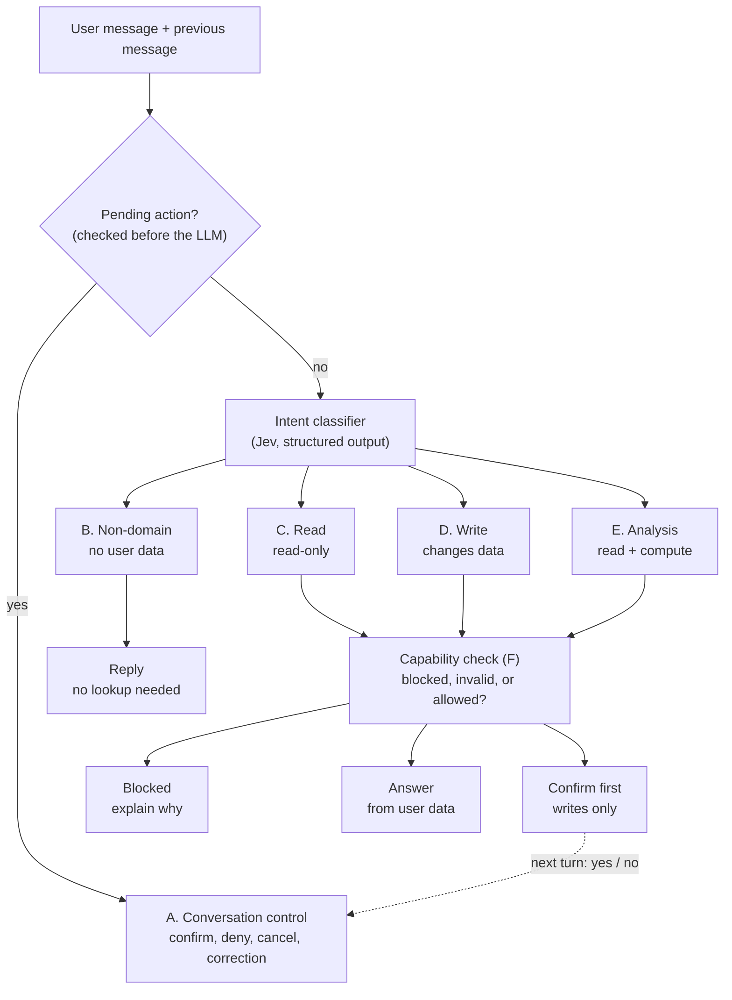
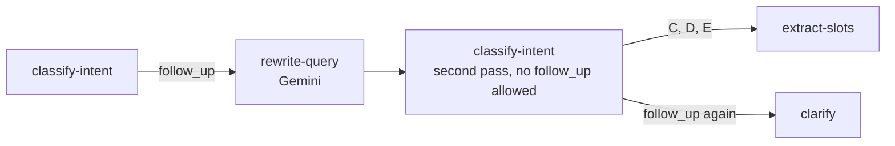

# Savvist — Chat Assistant Architecture & Implementation Status

This document details the architecture, component breakdown, and implementation status of the AI Chat Assistant module (`apps/savvist-backend/src/app/modules/chat`).

**Contents**

1. [Overview](#1-overview)
2. [Directory Structure & Implementation Status](#2-directory-structure--implementation-status)
3. [LangGraph Agent Workflow Architecture](#3-langgraph-agent-workflow-architecture)
4. [Design Decisions](#4-design-decisions)
5. [Open Points](#5-open-points)

---

## 1. Overview

The chat assistant is built on a **LangGraph state machine** integrated with **NestJS**. It uses **Jev (TypeSafe AI)** for intent classification and **Google Gemini** for slot extraction, query rewriting, and reply generation. It features durable state persistence via MongoDB checkpointers, strict policy enforcement, and an explicit human-in-the-loop confirmation workflow for write operations.

---

## 2. Directory Structure & Implementation Status

All components under `apps/savvist-backend/src/app/modules/chat/` are implemented, except the changes marked below:

- **[TO ADD]**: a new file.
- **[TO UPDATE]**: an existing file whose behavior changes because of the decisions recorded in this document.

Details for each marked file are in [Planned changes](#planned-changes) below the tree.

```
apps/savvist-backend/src/app/modules/chat/
├── chat.module.ts                    # Root chat module importing conversations, messages, and agent
├── conversations/                    # Conversation management controllers & services
├── messages/                         # Message persistence and streaming controllers & services
└── agent/                            # AI agent domain
    ├── agent.module.ts               # Wires agent services, graph, intent classifiers, and tools
    ├── agent.service.ts              # [TO UPDATE] Entry point (`run`, `resume`, `stream`)
    ├── agent.service.spec.ts         # Unit tests for agent execution flow
    │
    ├── graph/                        # LangGraph workflow
    │   ├── agent.graph.ts            # [TO UPDATE] StateGraph builder, nodes, edges, compiled checkpointer
    │   ├── agent.state.ts            # [TO UPDATE] Graph state schema, defined with Annotation.Root
    │   ├── pending-action.schema.ts  # [TO ADD] Zod schema for pending_action
    │   ├── agent.routers.ts          # [TO UPDATE] Conditional routing functions
    │   └── nodes/                    # 14 nodes: 13 existing, plus prepare-action
    │       ├── load-context.node.ts        # Loads user profile, date, and previous context
    │       ├── state-guard.node.ts         # [TO UPDATE] Handles answers to a clarification question
    │       ├── classify-intent.node.ts     # Invokes intent classifier
    │       ├── extract-slots.node.ts       # Gemini slot extraction
    │       ├── capability-check.node.ts    # Validates against policy and capability rules
    │       ├── clarify.node.ts             # Handles ambiguity or unknown intents
    │       ├── blocked.node.ts             # Formulates refusal messages for forbidden actions
    │       ├── read-data.node.ts           # Fetches relevant financial records
    │       ├── analyze.node.ts             # Performs financial calculations (affordability, what-if)
    │       ├── prepare-action.node.ts      # [TO ADD] Builds pending_action before the confirmation pause
    │       ├── confirm-first.node.ts       # [TO UPDATE] Calls interrupt()
    │       ├── resolve-confirmation.node.ts# [TO UPDATE] Resolves confirmation / denial / correction
    │       ├── execute-write.node.ts       # [TO UPDATE] Executes authorized write operations
    │       └── respond.node.ts             # Generates final user-facing response via Gemini
    │
    ├── intent/                       # Intent classification subsystem
    │   ├── intent.types.ts           # Intent groups, intents, entities, results
    │   ├── intent.taxonomy.ts        # Intent-to-group and intent-to-entity mapping
    │   ├── risk-tier.ts              # Code-only risk mapping. Read by prepare-action
    │   ├── state-guards.ts           # State validation guards
    │   ├── scores-to-result.ts       # Threshold evaluation for classifier scores
    │   ├── intent-classifier.interface.ts  # Classifier abstraction
    │   ├── intent-classifier.token.ts      # NestJS DI token
    │   └── classifiers/
    │       ├── jev.classifier.ts     # Primary Jev (TypeSafe AI) classifier
    │       ├── jev.client.ts         # HTTP adapter for Jev
    │       ├── jev.questions.ts      # Typed questions per intent
    │       └── keyword.classifier.ts # Baseline keyword classifier for evaluation
    │
    ├── llm/                          # Gemini LLM integration
    │   ├── gemini.service.ts         # Core Gemini client service
    │   ├── slot-extractor.ts         # Extracts numerical and entity slots
    │   ├── query-rewriter.ts         # Rewrites queries for semantic retrieval
    │   ├── reply-writer.ts           # Generates natural conversational responses
    │   └── prompts/                  # System prompts for slots, queries, and replies
    │
    ├── capability/                   # Deterministic policy rules
    │   ├── capability-check.service.ts
    │   └── rules/
    │       ├── read-only-data.rule.ts
    │       ├── future-data.rule.ts
    │       ├── account-type-lock.rule.ts
    │       ├── unsupported-feature.rule.ts
    │       └── policy-flag.rule.ts   # Enforces config flags for deletes & base salary changes
    │
    ├── tools/                        # Domain adapters & memory tools
    │   ├── read.tool.ts              # Fetches balances, metrics, expenses, wishlist, logs, profile
    │   ├── write.tool.ts             # Executes write intents (expenses, wishlist, base salary, accounts)
    │   ├── memory.tool.ts            # Manages cross-conversation persistent agent memory (`agentMemories`)
    │   └── tool-registry.ts          # Intent-to-tool mapping registry
    │
    ├── persistence/                  # State persistence
    │   └── mongo-checkpointer.provider.ts # [TO UPDATE] MongoDBSaver checkpointer with Mongoose connection reuse
    │
    └── eval/                         # Evaluation harness
        ├── eval-intents.ts           # Accuracy and write-boundary evaluation suites
        ├── cases.jsonl               # Test case corpus
        └── seed-cases.ts             # Seed cases generator
```

### Planned changes

| File | Change | Details |
|---|---|---|
| `agent.service.ts` | Update | Add the ownership check, paused-thread detection from the saved state, and the pending-action expiry check before each turn (see [4.2](#42-pause-detection)) |
| `graph/agent.graph.ts` | Update | Add the `prepare-action` node, entered from `capability-check` (write allowed) and from `execute-write` (409) |
| `graph/agent.state.ts` | Update | State defined with `Annotation.Root` (`messages`, `intentResult`, `pending_action`, etc.). See [4.1](#41-state-definition-style) |
| `graph/pending-action.schema.ts` | Add | Zod schema for `pending_action` (`tool`, `args`, `risk`, `createdAt`, `expiresAt`). Used by `prepare-action` and `resolve-confirmation` |
| `graph/agent.routers.ts` | Update | A write that passes `capability-check` goes to `prepare-action` |
| `nodes/state-guard.node.ts` | Update | Handles answers to a clarification question only. Paused confirmations are detected in `agent.service` |
| `nodes/prepare-action.node.ts` | Add | Builds `pending_action` from the completed slots, with risk from `risk-tier.ts` and an expiry time. Adds conflict details on the 409 loop (see [4.4](#44-prepare-action)) |
| `nodes/confirm-first.node.ts` | Update | Calls `interrupt()` only, so a restart on resume repeats nothing else |
| `nodes/resolve-confirmation.node.ts` | Update | Parses `pending_action` with its schema, treats an expired one as cancelled, then resolves confirmation / denial / correction |
| `nodes/execute-write.node.ts` | Update | Executes authorized write operations. Safe to retry. On a 409 it goes back to `prepare-action` |
| `persistence/mongo-checkpointer.provider.ts` | Update | Async provider, explicit `dbName`, `setup()` at startup (see [4.3](#43-mongodbsaver-setup)) |

---

## 3. LangGraph Agent Workflow Architecture

Two views of the same workflow. The high-level view shows the routing order for every message. The detailed view shows the LangGraph nodes, the `interrupt()` pause and the loops.

### 3.1 Decisions reflected in the workflow

- `undo_last` is dropped. "Undo that" is a blocked request (`unsupported_feature`).
- Follow-ups use **option C**: there is no `follow_up` intent. Jev receives the previous assistant message as context and picks the real intent directly. Gemini produces the standalone query together with the slots. Option B is the documented fallback (see [3.6](#36-fallback-for-follow-ups-option-b)).
- On resume, LangGraph restarts the paused node from its beginning. So `confirm-first` contains only the `interrupt()` call, and `pending_action` is built in a separate `prepare-action` node before it.

### 3.2 High-level routing



### 3.3 Detailed LangGraph workflow


### 3.4 How the two main diagrams relate

| High-level | Detailed |
|---|---|
| Pending action check | Split in two: `agent.service` checks for a paused interrupt, and `state-guard` handles answers to a clarification question |
| A. Conversation control | Split across `state-guard` (clarification answers) and `resolve-confirmation` (`confirm`, `deny`, `cancel`, `correction`). There is no `follow_up` or `undo_last` intent |
| Intent classifier | `classify-intent` (Jev, with the previous message as context), plus `extract-slots` (Gemini) for slots and the standalone query |
| Capability check (F) | `capability-check`, with code-only rules |
| Answer | `read-data` and `analyze` |
| Confirm first | `prepare-action` (builds `pending_action`) then `confirm-first` (calls `interrupt()`) |
| Next turn: yes / no | The dotted loop through `Waiting for user` and the `Entry` check |

### 3.5 Additions in the detailed view

These appear in the detailed view only, not in the high-level one:

- `clarify` for `unknown` intents and missing slots, including `log_spending`.
- `prepare-action`, so that nothing but the `interrupt()` call runs again when a paused node restarts on resume.
- A `correction` loop back to `extract-slots`, so changed parameters pass the capability check again (for example, a corrected date that turns out to be in the future).
- A "new request" loop back to `classify-intent` when the user ignores the pending question.
- A 409 `confirmReplace` loop from `execute-write` back to `prepare-action`.

### 3.6 Fallback for follow-ups (option B)

Use only if the eval shows Jev cannot reliably resolve follow-ups from the previous message (option C). It reintroduces `follow_up` as an intent in group A and adds a `rewrite-query` node. A state flag (`rewriteAttempted`) stops loops: the second pass may not return `follow_up`, and if it does, the message goes to `clarify`.



---

## 4. Design Decisions

### 4.1 State definition style

The graph state in `agent.state.ts` is defined with `Annotation.Root`. `StateSchema` and Zod object schemas are also accepted by `StateGraph`, so this is a choice rather than a constraint.

**Why `Annotation.Root`**

- The LangGraph JS docs recommend it for new graphs. `StateSchema` (announced December 2025) is an additional schema-first option, and the existing Annotation API continues to work unchanged.
- The checkpointer, state snapshots and most LangGraph examples assume it, which lowers risk while other points here (pause detection, `MongoDBSaver`) depend on library behavior.
- The state is mostly plain fields: `messages` with a reducer, `intentResult`, `pending_action`, `awaiting_clarification` and `rewriteAttempted`. It does not need schema-first features.
- Zod-based state has shown type friction. One LangGraph docs change moved a quickstart from Zod to Annotation to fix type incompatibilities.

**Runtime validation for `pending_action`**

`pending_action` is saved to Mongo and read back on a later turn, possibly after a deploy. Validate it at that boundary without changing the state style:

- Define a separate Zod schema for `pending_action`.
- Parse the value when `resolve-confirmation` reads it.
- If parsing fails, treat the action as cancelled and tell the user. A malformed or outdated action must never reach `execute-write`.

**When to revisit**

Switch to `StateSchema` only if the project wants the state type and runtime validation from a single definition, and is already on Zod 4 or another Standard Schema library. Check the installed `@langchain/langgraph` and Zod versions first.

### 4.2 Pause detection

The `Entry` check in the detailed diagram is answered in `agent.service`, before the graph is invoked, by reading the saved thread state. It is not a graph node.

**How it works**

- At the start of every turn, `agent.service` asks the graph for the saved state snapshot of the thread (`getState` with the `thread_id`). This works at any time because the checkpointer persists the state, not only right after an `invoke`.
- The snapshot has a `next` list (nodes that will run next) and a `tasks` list. Each task carries an `interrupts` list.
- The thread is paused when any task has a non-empty `interrupts` list. This is the primary test, because `next` can also be non-empty after a crash or a failed node, which is not a real pause.
- Fallback if the installed version lacks `interrupts` on tasks: treat the thread as paused when `next` contains `confirm-first`.

**Routing after the check**

- Paused: resume the graph with the user's message as the resume value. `interrupt()` inside `confirm-first` returns that message, and the graph continues to `resolve-confirmation`.
- Not paused: start a fresh run with the user's message, beginning at `load-context`.
- The same check and the same two paths apply to `run`, `resume` and `stream`.

**Rules that go with it**

- **Ownership first.** The thread has no `userId` of its own. Check that the conversation belongs to the user before reading the saved state or invoking the graph (`DATABASE.md` section 4.10).
- **Expiry.** `pending_action` carries an `expiresAt` (`DATABASE.md` section 4.8). If it has passed, treat the action as cancelled and start a fresh run instead of resuming. The `resolve-confirmation` "new request" branch already covers a user who ignores the pending question.
- **Concurrency.** Two messages on the same thread can both see the thread as paused. Serialize turns per thread with a lock or queue.
- **Clarification is separate.** `awaiting_clarification` is ordinary graph state, not an interrupt, so the snapshot check does not detect it. `state-guard` keeps reading it from the loaded state.
- **Persistence dependency.** Detection only works if checkpoints persist across requests, so test it against the real `MongoDBSaver` (see [4.3](#43-mongodbsaver-setup)).

### 4.3 MongoDBSaver setup

The checkpointer is `MongoDBSaver` from `@langchain/langgraph-checkpoint-mongodb`. It is installed together with the `mongodb` driver. The collection design and rules are in `DATABASE.md` section 4.10, and this section is the implementation checklist for `mongo-checkpointer.provider.ts`.

**Setup**

- The constructor takes an options object with a required `client` and optional `dbName`, `checkpointCollectionName`, `checkpointWritesCollectionName` and `enableTimestamps`. MongoDB's own integration page still shows the older form that passes the client alone, so follow the LangChain docs.
- There is no connection-string helper. Build a `MongoClient` (or reuse Mongoose's), construct the saver, and call `setup()` once at startup so the indexes exist.
- Keep the default collection names, `checkpoints` and `checkpoint_writes`. Application code never writes to them.
- Set `dbName` explicitly, to the same database the app uses, so checkpoints don't land in an unexpected database.

**Reusing the Mongoose connection**

- Mongoose's `connection.getClient()` returns the `MongoClient` behind its connection. Build the saver in an async provider that injects the Mongoose connection and waits until it is ready.
- Never close that client from the saver. Mongoose owns it.
- Mongoose bundles its own `mongodb` driver. If its version differs from the one the checkpointer depends on, the two `MongoClient` types can be reported as incompatible. Run `npm ls mongodb` after installing and align the versions. Cast only as a last resort.
- Fallback: open a second `MongoClient` with the same connection string.

**State size**

- LangGraph writes a checkpoint at every super-step, not once per user message, so a single conversation produces many checkpoints.
- A MongoDB checkpoint is limited to one 16 MB document. Keep graph state small: store IDs and arguments, not query results, and use only plain serializable values.

**Retention**

- `DATABASE.md` proposes a `ttl` option on the saver. This could not be confirmed for the JavaScript saver. The Python saver has one, the JavaScript parameters reference lists `enableTimestamps` instead, and the TTL configuration in the JavaScript package belongs to `MongoDBStore`, not the saver.
- First check whether the installed saver accepts a `ttl` option. If it does, use it as `DATABASE.md` describes.
- If it does not, turn on `enableTimestamps`, which adds an `upserted_at` date on each write, and create a TTL index on that field for both collections in the provider. This conflicts with the "no custom indexes" line in `DATABASE.md` section 4.10, so update that document if the fallback is used.
- TTL ages out individual checkpoints, so an idle conversation can lose its agent memory. `messages` keeps the visible history, and `pending_action` has its own shorter `expiresAt`.

**Deleting a conversation**

- `deleteThread(threadId)` removes a thread's checkpoints and writes. Only the conversation delete endpoint calls it, after the transaction that deletes the conversation and its messages. It may use a different client, so it cannot join that transaction. Make it idempotent and safe to retry.

**Test before relying on it**

- Restart simulation: run a turn to `interrupt()`, build a fresh graph and saver as if the server restarted, confirm the pause is still detected, then resume and confirm the graph reaches `resolve-confirmation`.
- Ownership: confirm that a user cannot read or resume another user's thread.
- Deletion: confirm that `deleteThread` leaves no documents for that thread in either collection.

### 4.4 prepare-action

`prepare-action` is a separate node between `capability-check` and `confirm-first`. `pending_action` is not built at the end of `capability-check`.

**Why a separate node**

- On resume, LangGraph restarts the paused node from its beginning. If `confirm-first` built the action, that work would run again. A separate node runs once, and a checkpoint is saved after it, so `pending_action` is stored before the pause.
- The 409 `confirmReplace` loop needs a node to return to that rebuilds `pending_action` with the conflict details, which become a second confirm step (`DATABASE.md` sections 4.8 and 4.10). If the action were built in `capability-check`, that loop would have to re-run every policy rule or duplicate the building logic.
- `capability-check` stays a pure policy gate that decides allowed, blocked or invalid. Building an action is a different job with different tests.
- Risk is derived in code only, from `risk-tier.ts`, never from the model.

**What the node does**

- Input: a write intent whose slots are complete and that passed `capability-check`.
- Output: `pending_action` with `tool`, `args`, `risk`, `createdAt` and `expiresAt` (`DATABASE.md` section 4.8).
- Values are plain and serializable: IDs and arguments, dates as `YYYY-MM-DD` strings, no `Date` instances or class objects (`DATABASE.md` section 4.10).
- The result is checked against `pending-action.schema.ts` before it is saved to state.
- The expiry window comes from configuration and should be shorter than the checkpoint retention period.
- No model call and no data reads or writes. It is pure code.
- On the 409 path it also stores the conflict details (existing and proposed balances) in `pending_action`.
- The confirmation text shown to the user is produced from `pending_action` and saved as a normal assistant message (`DATABASE.md` section 4.8).

**Edges**

- `capability-check` (write allowed) to `prepare-action`, then to `confirm-first`.
- `execute-write` (409 `confirmReplace`) to `prepare-action`, then to `confirm-first`.
- A `correction` from `resolve-confirmation` goes back through `extract-slots` and `capability-check`, so it also reaches `prepare-action` and the pending action is rebuilt with the corrected values.

**Tests to add**

- Risk comes from `risk-tier.ts` for every write intent.
- `expiresAt` is set from the configured window.
- The schema rejects a malformed action.
- The 409 path includes the conflict details.
- After the correction loop, the rebuilt `pending_action` has the corrected values.

---

## 5. Open Points

- **Pause detection: design resolved, version check pending.** See [4.2](#42-pause-detection). Before building it, confirm in the installed `@langchain/langgraph` version that task snapshots expose an `interrupts` list. If they don't, use the `next` list as the fallback test.
- **State definition style: decided.** See [4.1](#41-state-definition-style). Use `Annotation.Root` for `agent.state.ts`.
- **MongoDBSaver: design agreed, install-time checks pending.** See [4.3](#43-mongodbsaver-setup) and `DATABASE.md` section 4.10. Still to confirm after install: the single `mongodb` driver version, `getClient()` on the installed Mongoose version, and whether the saver has a `ttl` option (see Retention in 4.3).
- **`prepare-action`: decided.** See [4.4](#44-prepare-action). It stays a separate node and is now in the scaffold.
- **Option C is untested.** Add follow-up cases to `cases.jsonl` (for example "What about last month?" after different assistant answers) and compare against option B.