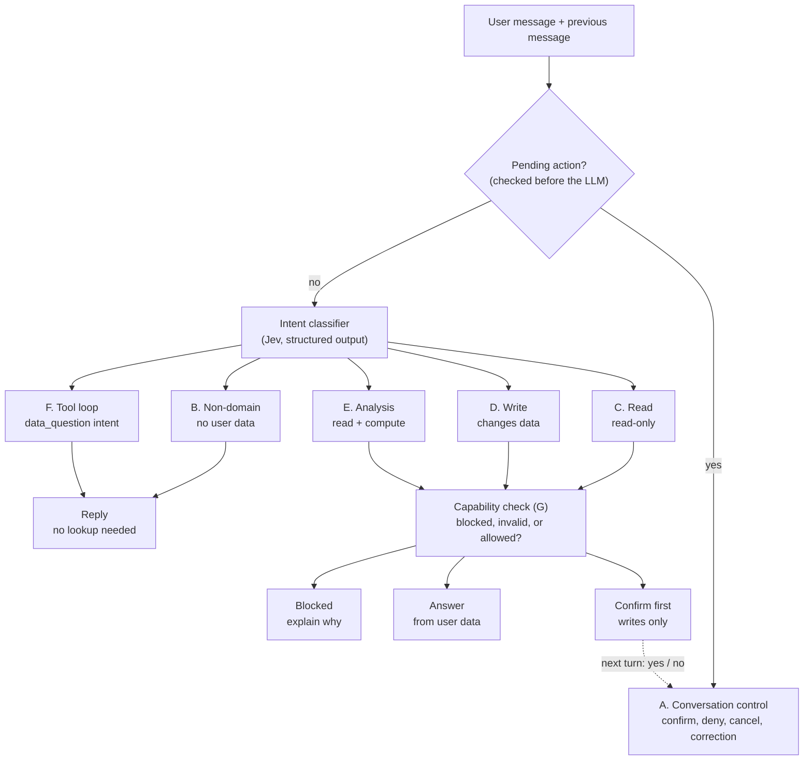
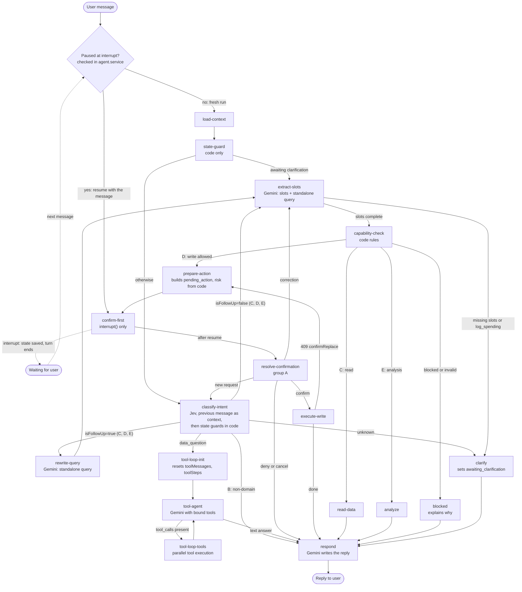
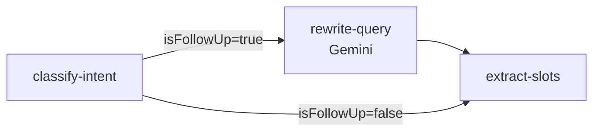

# Savvist Chat Assistant Architecture & Implementation Status

This document details the architecture, component breakdown, and implementation status of the AI Chat Assistant module (`apps/savvist-backend/src/app/modules/chat`).

**Contents**

1. [Overview](#1-overview)
2. [Directory Structure & Implementation Status](#2-directory-structure--implementation-status)
3. [LangGraph Agent Workflow Architecture](#3-langgraph-agent-workflow-architecture)
4. [Design Decisions](#4-design-decisions)
5. [Open Points](#5-open-points)

---

## 1. Overview

The chat assistant is built on a **LangGraph state machine** integrated with **NestJS**. It uses **Jev (TypeSafe AI)** for intent classification and **Google Gemini** for slot extraction, query rewriting, and reply generation. It features durable state persistence via MongoDB checkpointers, strict policy enforcement, and an explicit human-in-the-loop confirmation workflow for write operations. It is a daily-money assistant: balances, spending, expenses, wishlist and reminders for one user. Large purchases, loans, investing, and tax or legal advice are out of scope ([4.6](#46-boundaries-and-legal-safety)).

---

## 2. Directory Structure & Implementation Status

```
apps/savvist-backend/src/app/modules/chat/
|-- chat.module.ts                              # 27 lines -- Root chat module importing conversations, messages, and agent
|-- conversations/                              # Conversation management controllers & services
|   |-- dto/
|   |   |-- create-conversation.dto.ts          # 12 lines
|   |   \-- update-conversation.dto.ts          # 3 lines
|   |-- schemas/
|   |   \-- conversation.schema.ts              # 16 lines
|   |-- conversations.controller.ts             # 60 lines
|   |-- conversations.controller.spec.ts        # 45 lines
|   |-- conversations.service.ts                # 62 lines
|   \-- conversations.service.spec.ts           # 62 lines
|-- messages/                                   # Message persistence and streaming controllers & services
|   |-- dto/
|   |   \-- create-message.dto.ts               # 17 lines
|   |-- schemas/
|   |   \-- message.schema.ts                   # 19 lines
|   |-- messages.controller.ts                  # 51 lines
|   |-- messages.controller.spec.ts             # 52 lines
|   |-- messages.service.ts                     # 101 lines
|   \-- messages.service.spec.ts                # 122 lines
\-- agent/                                      # AI agent domain
    |-- agent.module.ts                         # 77 lines -- Wires agent services, graph, intent classifiers, LLM services, tools, and ObservabilityModule
    |-- agent.service.ts                        # 96 lines -- Entry point (run); per-thread serialization queue for concurrency control
    |-- agent.service.spec.ts                   # 39 lines -- Unit tests for agent execution flow
    |
    |-- graph/                                  # LangGraph workflow
    |   |-- agent.graph.ts                      # 126 lines -- StateGraph builder; 15 nodes, all edges, compiled checkpointer
    |   |-- agent.state.ts                      # 27 lines -- Graph state schema defined with Annotation.Root
    |   |-- agent.routers.ts                    # 95 lines -- Conditional routing functions (routeAfterGuard, routeAfterClassify, routeAfterSlots, routeAfterCapability, routeAfterToolAgent, routeAfterResolve, routeAfterExec)
    |   |-- agent.routers.spec.ts               # 42 lines -- Tests for routeAfterClassify
    |   |-- pending-action.schema.ts            # 0 lines  -- Zod schema for pending_action (stub)
    |   |-- studio.ts                           # 20 lines -- LangGraph Studio dev entrypoint
    |   |-- turn-context.ts                     # 42 lines -- Per-turn shared context; TurnContext, UserProfile, UserContextProvider, ReminderCounter interfaces; todayIn(), isValidTimeZone()
    |   \-- nodes/
    |       |-- load-context.node.ts            # 76 lines -- Loads profile, resolves timezone, computes today, counts due reminders; builds TurnContext
    |       |-- state-guard.node.ts             # 43 lines -- Resets or preserves state between turns; enforces max clarification turn limit
    |       |-- state-guard.node.spec.ts        # 73 lines -- Tests for state reset, preservation, and turn-limit wipe
    |       |-- classify-intent.node.ts         # 76 lines -- Invokes Jev classifier with last user + previous assistant message; applies state guards
    |       |-- rewrite-query.node.ts           # 50 lines -- Rewrites elliptical follow-up queries via Gemini (QueryRewriter); bypasses when no prior history
    |       |-- rewrite-query.node.spec.ts      # 60 lines -- Tests for rewrite and bypass paths
    |       |-- extract-slots.node.ts           # 59 lines -- Gemini slot extraction; uses rewrittenQuery when isFollowUp; overrides standaloneQuery if empty
    |       |-- extract-slots.node.spec.ts      # 135 lines -- Tests for lastUserMessage vs rewrittenQuery selection and standaloneQuery override
    |       |-- capability-check.node.ts        # 62 lines -- Calls CapabilityCheckService; merges capabilityCheck into intentResult
    |       |-- capability-check.node.spec.ts   # 82 lines -- Tests for capabilityCheckNodeFactory and blockedNodeFactory
    |       |-- clarify.node.ts                 # 7 lines  -- Stub: formulates clarification question (TODO)
    |       |-- blocked.node.ts                 # 29 lines -- Sets executed node; supplies default refusal if capabilityCheck.reason is missing
    |       |-- read-data.node.ts               # 70 lines -- Routes by intent to ReadTool; returns readResult; throws if userId missing
    |       |-- analyze.node.ts                 # 7 lines  -- Stub: pure data analysis/calculations (TODO)
    |       |-- tool-loop.nodes.ts              # 149 lines -- Three nodes: toolLoopInitNode (resets toolMessages/toolSteps/toolAnswer), toolAgentNodeFactory (Gemini with bound tools; MAX_TOOL_STEPS=5; sufficiency guard), toolsNodeFactory (parallel tool execution; deduplicates repeated calls)
    |       |-- prepare-action.node.ts          # 7 lines  -- Stub: builds pending_action, derives risk, sets expiry (TODO)
    |       |-- confirm-first.node.ts           # 10 lines -- Calls interrupt({ pending_action }) to pause graph
    |       |-- resolve-confirmation.node.ts    # 7 lines  -- Stub: validates pending_action schema; resolves confirm/deny/cancel/correction/new_request (TODO)
    |       |-- execute-write.node.ts           # 7 lines  -- Stub: executes approved write action idempotently / handles conflicts (TODO)
    |       |-- respond.node.ts                 # 86 lines -- Gemini reply; handles blocked, cancel/deny, non-domain smalltalk, clarification, analysis disclaimer, read reply; prepends due reminder prefix
    |       \-- respond.node.spec.ts            # 82 lines -- Tests for clarification, due reminders prefix, analysis disclaimer, capability reason forwarding
    |
    |-- intent/                                 # Intent classification subsystem
    |   |-- intent.types.ts                     # 70 lines -- Intent groups, intents (JevIntentName, IntentName), IntentResult, ClassifierInput
    |   |-- intent.taxonomy.ts                  # 126 lines -- Full intent taxonomy: group, description; includes special data_question intent
    |   |-- risk-tier.ts                        # 0 lines  -- Code-only risk mapping (stub)
    |   |-- state-guards.ts                     # 10 lines -- applyStateGuards(): pass-through (placeholder for future guards)
    |   |-- score-to-result.ts                  # 75 lines -- Converts Jev ChoiceAnswer to IntentResult; applies minConfidence/minMargin; collects secondary non-domain intents
    |   |-- assistant-profile.ts                # 17 lines -- ASSISTANT_PROFILE constants (name, creator, purpose, capabilities list)
    |   |-- intent-classifier.interface.ts      # 0 lines  -- Classifier abstraction (stub)
    |   |-- intent-classifier.token.ts          # 1 line   -- NestJS DI token (INTENT_CLASSIFIER)
    |   \-- classifiers/
    |       |-- jev.classifier.ts               # 23 lines -- JevIntentClassifier: classify() → scoreToResult(); falls back to keyword classifier or unknown on error
    |       |-- jev.client.ts                   # 93 lines -- JevClient: classifyIntent(), checkSemanticPolicy() (Noul >= 0.7 → isProhibited), checkIsFollowUp(); logs via observability
    |       |-- jev.questions.ts                # 38 lines -- Builds 3 TypeSafe questions: intent (choice), prohibited_advice_or_topic (noul), is_follow_up_or_elliptical (noul)
    |       \-- keyword.classifier.ts           # 0 lines  -- Baseline keyword classifier (stub)
    |
    |-- llm/                                    # Gemini LLM integration
    |   |-- gemini.service.ts                   # 25 lines -- GeminiService: wraps ChatGoogleGenerativeAI (default gemini-1.5-flash, temp 0.2); exposes getModel()
    |   |-- slot-extractor.ts                   # 133 lines -- SlotExtractor: extract(); SlotSchema (Zod); WishlistQueryArgs path; graceful fallback on parse error
    |   |-- slot-extractor.spec.ts              # 169 lines -- Tests for SlotSchema null-tolerance; extract with observability; graceful fallback
    |   |-- query-rewriter.ts                   # 61 lines -- QueryRewriter: rewrite(); strips wrapping quotes/backticks; falls back to original message on error
    |   |-- query-rewriter.spec.ts              # 62 lines -- Tests for rewrite and error fallback
    |   |-- reply-writer.ts                     # 31 lines -- ReplyWriter: writeReply(); strips leading greeting pattern; falls back to generic message on error
    |   |-- reply-writer.spec.ts                # 76 lines -- Tests for greeting prefix stripping and wishlist aggregation formatting
    |   \-- prompts/                            # System prompts for slots, queries, and replies
    |       |-- reply.prompt.ts                 # 34 lines -- buildReplyPrompt(): data-only answer; quote-exact figures; wishlist truncated/appliedFilters/aggregate rules
    |       |-- slot-extractor.prompt.ts        # 91 lines -- buildSlotExtractorPrompt(): wishlist path (full readArgs JSON schema) vs default path (simpler schema); history included
    |       |-- slot-extractor.prompt.spec.ts   # 35 lines -- Tests for wishlist markers, dynamic limit, and no biased hardcoded examples
    |       |-- standalone-query.prompt.ts      # 24 lines -- buildStandaloneQueryPrompt(): rewrites elliptical queries; resolve pronouns, carry predicates/superlatives; output only rewritten question
    |       \-- standalone-query.prompt.spec.ts # 16 lines -- Tests for prompt identity and rewriting rules
    |
    |-- capabilities/                           # Deterministic policy rules
    |   |-- capability-check.service.ts         # 83 lines -- CapabilityCheckService: runs sync rules first, then async unsupportedFeatureRule; merges config flags from ConfigService
    |   |-- capability-check.service.spec.ts    # 233 lines -- Tests for all 7 rules
    |   \-- rules/
    |       |-- read-only-data.rule.ts          # 24 lines -- Blocks write attempts on record_logs (read-only audit trail)
    |       |-- future-data.rule.ts             # 20 lines -- Blocks manage_entry_record when slots.date > today
    |       |-- account-type-lock.rule.ts       # 20 lines -- Blocks account type change once records exist
    |       |-- policy-flag.rule.ts             # 27 lines -- Enforces ALLOW_SALARY_CHANGE and ALLOW_DELETES config flags
    |       |-- large-amount.rule.ts            # 30 lines -- Blocks analysis intents when amount > LARGE_AMOUNT_MULTIPLE * user.netIncome (default multiple: 6)
    |       |-- reminder-date.rule.ts           # 20 lines -- Blocks manage_reminder when reminder date is in the past
    |       \-- unsupported-feature.rule.ts     # 52 lines -- Async rule: blocks undo/revert, conversation management, out-of-scope intent, semantic policy via Jev Noul >= 0.7
    |
    |-- tools/                                  # Domain adapters, data tools & memory tools
    |   |-- read.tool.ts                        # 221 lines -- ReadTool: getBalances, getExpenses, listExpensesByDueDate, getExpenseById, queryWishlist, getRecordLogs, getProfile; plain() serializer; observability logging
    |   |-- read.tool.spec.ts                   # 183 lines -- Tests for expense enrichment, listExpensesByDueDate sorting, getExpenseById, queryWishlist aggregation
    |   |-- data-tools.ts                       # 251 lines -- createDataTools(): 6 LangChain tools (getCurrentDate, normalizeDate, getUpcomingExpenses, getAllExpenseDateSorted, countDaysUntilExpenseDue, countDaysBetweenDates); filterAndSortExpensesByDueDate, countDaysUntilExpenseDueCore, countDaysBetweenDatesCore helpers
    |   |-- data-tools.spec.ts                  # 101 lines -- Tests for filterAndSortExpensesByDueDate, countDaysUntilExpenseDueCore, countDaysBetweenDatesCore
    |   |-- date-utils.ts                       # 169 lines -- Pure date helpers: todayIn, toIso, daysBetween, addDays, daysInMonth, computeNextDueDate, computeExpenseDueDateInfo, normalizeDate (free-text date parsing)
    |   |-- date-utils.spec.ts                  # 95 lines -- Tests for all date-utils functions
    |   |-- write.tool.ts                       # 0 lines  -- Executes write intents (stub)
    |   |-- memory.tool.ts                      # 0 lines  -- Agent memory: list, save, forget (stub)
    |   \-- tool-registry.ts                    # 0 lines  -- Intent-to-tool mapping registry (stub)
    |
    |-- observability/                          # Per-turn observability and logging
    |   |-- observability.module.ts             # 9 lines  -- NestJS module wrapping ObservabilityService
    |   |-- observability.service.ts            # 143 lines -- Per-turn store: SetExecutedNode, SetLLMCall, SetToolCall, SetLLMToolCall, SetUserMessage, SetResponse (writes to logs.json); reset() between turns
    |   |-- observability.service.spec.ts       # 62 lines -- Tests for node/llm/tool storage and log file write on SetResponse
    |   |-- logs.json                           # Runtime log file (gitignored)
    |   \-- prev-logs.json                      # Previous session log file (gitignored)
    |
    \-- persistence/                            # State persistence
        \-- mongo-checkpointer.provider.ts      # 26 lines -- MongoDBSaver from @langchain/langgraph-checkpoint-mongodb; reuses Mongoose connection's native client; calls saver.setup?() at startup
```

---

## 3. LangGraph Agent Workflow Architecture

Two views of the same workflow. The high-level view shows the routing order for every message. The detailed view shows the LangGraph nodes, the `interrupt()` pause and the loops.

### 3.1 Decisions reflected in the workflow

- `undo_last` is dropped. "Undo that" is a blocked request (`unsupported_feature`).
- Follow-ups use the `rewrite-query` node (option C/B hybrid): Jev classifies intent and sets `isFollowUp=true`; `routeAfterClassify` sends the message to `rewrite-query` before `extract-slots`. On the second classify pass, `follow_up` is not a valid intent result.
- On resume, LangGraph restarts the paused node from its beginning. So `confirm-first` contains only the `interrupt()` call, and `pending_action` is built in a separate `prepare-action` node before it.
- Reminders, wishlist swap, safe-to-spend, spending review, and agent memory add no new graph nodes. They use the existing path.
- `data_question` is a special intent that bypasses slot extraction and goes directly to the tool loop (`tool-loop-init` → `tool-agent` → `tool-loop-tools`).

### 3.2 High-level routing



### 3.3 Detailed LangGraph workflow



### 3.4 How the two main diagrams relate

| High-level | Detailed |
|---|---|
| Pending action check | Split in two: `agent.service` checks for a paused interrupt, and `state-guard` handles answers to a clarification question |
| A. Conversation control | Split across `state-guard` (clarification answers) and `resolve-confirmation` (`confirm`, `deny`, `cancel`, `correction`). There is no `undo_last` intent |
| Intent classifier | `classify-intent` (Jev, with the previous message as context), plus `rewrite-query` (Gemini) for follow-ups, then `extract-slots` (Gemini) for slots and the standalone query |
| Capability check (G) | `capability-check`, with code-only sync rules followed by one async rule (`unsupportedFeatureRule`) |
| Answer | `read-data` and `analyze` |
| Tool loop (F) | `tool-loop-init` → `tool-agent` → `tool-loop-tools` loop for `data_question` intent |
| Confirm first | `prepare-action` (builds `pending_action`) then `confirm-first` (calls `interrupt()`) |
| Next turn: yes / no | The dotted loop through `Waiting for user` and the `Entry` check |

### 3.5 Additions in the detailed view

These appear in the detailed view only, not in the high-level one:

- `rewrite-query` for follow-up intents (`isFollowUp=true`), so the standalone query is resolved before slot extraction.
- `clarify` for `unknown` intents and missing slots, including `log_spending`.
- `tool-loop-init` → `tool-agent` → `tool-loop-tools` loop for `data_question` intent (at most `MAX_TOOL_STEPS=5` rounds).
- `prepare-action`, so that nothing but the `interrupt()` call runs again when a paused node restarts on resume.
- A `correction` loop back to `extract-slots`, so changed parameters pass the capability check again.
- A "new request" loop back to `classify-intent` when the user ignores the pending question.
- A 409 `confirmReplace` loop from `execute-write` back to `prepare-action`.

### 3.6 Fallback for follow-ups (option B)

The `rewrite-query` node is now live. `routeAfterClassify` sends `isFollowUp=true` messages to `rewrite-query` before `extract-slots`. On the second `classify-intent` pass (after a `rewrite-query`), `follow_up` is not a permitted intent result — if it appears again, the message goes to `clarify`. A `rewriteAttempted` state flag is not needed because the graph structure prevents re-entry into `rewrite-query`.



---

## 4. Design Decisions

### 4.1 State definition style

The graph state in `agent.state.ts` is defined with `Annotation.Root`. `StateSchema` and Zod object schemas are also accepted by `StateGraph`, so this is a choice rather than a constraint.

**Why `Annotation.Root`**

- The LangGraph JS docs recommend it for new graphs. `StateSchema` (announced December 2025) is an additional schema-first option, and the existing Annotation API continues to work unchanged.
- The checkpointer, state snapshots and most LangGraph examples assume it, which lowers risk while other points here (pause detection, `MongoDBSaver`) depend on library behavior.
- The state is mostly plain fields: `messages` with a reducer, `intentResult`, `slots`, `readResult`, `pending_action`, `awaiting_clarification`, `clarification_turns`, `rewrittenQuery`, `context`, and the tool loop fields (`toolMessages`, `toolSteps`, `toolAnswer`). It does not need schema-first features.
- Zod-based state has shown type friction. One LangGraph docs change moved a quickstart from Zod to Annotation to fix type incompatibilities.

**Current state fields**

| Field | Type | Description |
|---|---|---|
| `messages` | `BaseMessage[]` | Conversation history; uses `messagesStateReducer` |
| `intentResult` | `IntentResult \| null` | Classification result including `capabilityCheck` and `isFollowUp` |
| `slots` | `any \| null` | Extracted slots from Gemini |
| `readResult` | `any \| null` | Data fetched by `read-data`; cleared by `respond` |
| `pending_action` | `any \| null` | Action awaiting user confirmation |
| `awaiting_clarification` | `string \| null` | Clarification question asked |
| `clarification_turns` | `number` | Turn count within a clarification round |
| `context` | `TurnContext \| null` | Per-turn shared context (userId, today, timeZone, etc.) |
| `rewrittenQuery` | `string \| null` | Standalone query produced by `rewrite-query` |
| `toolMessages` | `BaseMessage[]` | Tool loop message history; resets to `[]` on `'reset'` |
| `toolSteps` | `number` | Current tool loop iteration count |
| `toolAnswer` | `string \| null` | Final text answer from tool agent |

**Runtime validation for `pending_action`**

`pending_action` is saved to Mongo and read back on a later turn, possibly after a deploy. Validate it at that boundary without changing the state style:

- Define a separate Zod schema for `pending_action` in `pending-action.schema.ts`.
- Parse the value when `resolve-confirmation` reads it.
- If parsing fails, treat the action as cancelled and tell the user. A malformed or outdated action must never reach `execute-write`.

**When to revisit**

Switch to `StateSchema` only if the project wants the state type and runtime validation from a single definition, and is already on Zod 4 or another Standard Schema library. Check the installed `@langchain/langgraph` and Zod versions first.

### 4.2 Pause detection

The `Entry` check in the detailed diagram is answered in `agent.service`, before the graph is invoked, by reading the saved thread state. It is not a graph node.

**How it works**

- At the start of every turn, `agent.service` asks the graph for the saved state snapshot of the thread (`getState` with the `thread_id`). This works at any time because the checkpointer persists the state, not only right after an `invoke`.
- The snapshot has a `next` list (nodes that will run next) and a `tasks` list. Each task carries an `interrupts` list.
- The thread is paused when any task has a non-empty `interrupts` list. This is the primary test, because `next` can also be non-empty after a crash or a failed node, which is not a real pause.
- Fallback if the installed version lacks `interrupts` on tasks: treat the thread as paused when `next` contains `confirm-first`.

**Routing after the check**

- Paused: resume the graph with the user's message as the resume value. `interrupt()` inside `confirm-first` returns that message, and the graph continues to `resolve-confirmation`.
- Not paused: start a fresh run with the user's message, beginning at `load-context`.
- The same check and the same two paths apply to `run`, `resume` and `stream`.

**Rules that go with it**

- **Ownership first.** The thread has no `userId` of its own. Check that the conversation belongs to the user before reading the saved state or invoking the graph (`DATABASE.md` section 4.10).
- **Expiry.** `pending_action` carries an `expiresAt` (`DATABASE.md` section 4.8). If it has passed, treat the action as cancelled and start a fresh run instead of resuming.
- **Concurrency.** `agent.service` serializes turns per thread with a `Map<string, Promise>` queue (`this.queues`). Two concurrent messages on the same thread are run sequentially.
- **Clarification is separate.** `awaiting_clarification` is ordinary graph state, not an interrupt, so the snapshot check does not detect it. `state-guard` keeps reading it from the loaded state.
- **Persistence dependency.** Detection only works if checkpoints persist across requests, so test it against the real `MongoDBSaver` (see [4.3](#43-mongodbsaver-setup)).

### 4.3 MongoDBSaver setup

The checkpointer is `MongoDBSaver` from `@langchain/langgraph-checkpoint-mongodb`. It is installed together with the `mongodb` driver. The collection design and rules are in `DATABASE.md` section 4.10, and this section is the implementation checklist for `mongo-checkpointer.provider.ts`.

**Setup**

- The constructor takes an options object with a required `client` and optional `dbName`, `checkpointCollectionName`, `checkpointWritesCollectionName` and `enableTimestamps`. MongoDB's own integration page still shows the older form that passes the client alone, so follow the LangChain docs.
- There is no connection-string helper. Build a `MongoClient` (or reuse Mongoose's), construct the saver, and call `setup()` once at startup so the indexes exist. The provider calls `saver.setup?.()` at initialization.
- Keep the default collection names, `checkpoints` and `checkpoint_writes`. Application code never writes to them.
- Set `dbName` explicitly, to the same database the app uses, so checkpoints don't land in an unexpected database.

**Reusing the Mongoose connection**

- Mongoose's `connection.getClient()` returns the `MongoClient` behind its connection. The provider injects the Mongoose connection and uses it directly.
- Never close that client from the saver. Mongoose owns it.
- Mongoose bundles its own `mongodb` driver. If its version differs from the one the checkpointer depends on, the two `MongoClient` types can be reported as incompatible. Run `npm ls mongodb` after installing and align the versions. Cast only as a last resort.
- Fallback: open a second `MongoClient` with the same connection string.

**State size**

- LangGraph writes a checkpoint at every super-step, not once per user message, so a single conversation produces many checkpoints.
- A MongoDB checkpoint is limited to one 16 MB document. Keep graph state small: store IDs and arguments, not query results, and use only plain serializable values.

**Retention**

- `DATABASE.md` proposes a `ttl` option on the saver. This could not be confirmed for the JavaScript saver. The Python saver has one, the JavaScript parameters reference lists `enableTimestamps` instead, and the TTL configuration in the JavaScript package belongs to `MongoDBStore`, not the saver.
- First check whether the installed saver accepts a `ttl` option. If it does, use it as `DATABASE.md` describes.
- If it does not, turn on `enableTimestamps`, which adds an `upserted_at` date on each write, and create a TTL index on that field for both collections in the provider.
- TTL ages out individual checkpoints, so an idle conversation can lose its agent memory. `messages` keeps the visible history, and `pending_action` has its own shorter `expiresAt`.

**Deleting a conversation**

- `deleteThread(threadId)` removes a thread's checkpoints and writes. Only the conversation delete endpoint calls it, after the transaction that deletes the conversation and its messages. It may use a different client, so it cannot join that transaction. Make it idempotent and safe to retry.

**Test before relying on it**

- Restart simulation: run a turn to `interrupt()`, build a fresh graph and saver as if the server restarted, confirm the pause is still detected, then resume and confirm the graph reaches `resolve-confirmation`.
- Ownership: confirm that a user cannot read or resume another user's thread.
- Deletion: confirm that `deleteThread` leaves no documents for that thread in either collection.

### 4.4 prepare-action

`prepare-action` is a separate node between `capability-check` and `confirm-first`. `pending_action` is not built at the end of `capability-check`.

**Why a separate node**

- On resume, LangGraph restarts the paused node from its beginning. If `confirm-first` built the action, that work would run again. A separate node runs once, and a checkpoint is saved after it, so `pending_action` is stored before the pause.
- The 409 `confirmReplace` loop needs a node to return to that rebuilds `pending_action` with the conflict details, which become a second confirm step (`DATABASE.md` sections 4.8 and 4.10). If the action were built in `capability-check`, that loop would have to re-run every policy rule or duplicate the building logic.
- `capability-check` stays a pure policy gate that decides allowed, blocked or invalid. Building an action is a different job with different tests.
- Risk is derived in code only, from `risk-tier.ts`, never from the model.

**What the node does (stub — TODO)**

- Input: a write intent whose slots are complete and that passed `capability-check`.
- Output: `pending_action` with `tool`, `args`, `risk`, `createdAt` and `expiresAt` (`DATABASE.md` section 4.8).
- Values are plain and serializable: IDs and arguments, dates as `YYYY-MM-DD` strings, no `Date` instances or class objects (`DATABASE.md` section 4.10).
- The result is checked against `pending-action.schema.ts` before it is saved to state.
- The expiry window comes from configuration and should be shorter than the checkpoint retention period.
- No model call and no data reads or writes. It is pure code.
- On the 409 path it also stores the conflict details (existing and proposed balances) in `pending_action`.

**Edges**

- `capability-check` (write allowed) to `prepare-action`, then to `confirm-first`.
- `execute-write` (409 `confirmReplace`) to `prepare-action`, then to `confirm-first`.
- A `correction` from `resolve-confirmation` goes back through `extract-slots` and `capability-check`, so it also reaches `prepare-action` and the pending action is rebuilt with the corrected values.

### 4.5 What the assistant can do

The assistant handles day-to-day money for one user. Intent names are illustrative; the final names live in `intent.types.ts`. Nothing here needs a new graph node.

| Capability | Group | Confirm first | Notes |
|---|---|---|---|
| Read balances, Total Fund, Actual Cash, Health, Growth, Today's Allowance and the 30-day trend, and explain any of them | C | no | Values come from `read.tool.ts`, never from the model |
| Read expenses (month total, what is due before the next payday), wishlist (pending total, next by priority), record logs, reminders, profile | C | no | Record logs are read-only |
| Ad-hoc data questions (expense schedules, day counts, upcoming bills) | F | no | `data_question` intent → tool loop using `data-tools.ts` tools |
| Update base salary and employment status | D | yes | Unemployed forces salary 0. Logged. Subject to `policy-flag.rule.ts` |
| Account entries: create, rename, delete | D | yes | Type cannot change once the account has records. Delete archives when records exist |
| Entry records: save a day's balance, change the amount, delete a day | D | yes, and again before replacing an existing balance | No future days. Only the amount changes, never the account type |
| Expenses: create, edit, delete | D | yes | |
| Wishlist: create, edit, delete, mark purchased, undo purchase | D | yes | |
| Wishlist: swap priority levels | D | yes, one confirmation | [4.8](#48-wishlist-priority-swap) |
| Reminders: create, edit, complete, delete (money owed to the user, expected payments, custom) | D | yes | [4.7](#47-reminders-and-relative-dates) |
| Memory: list, save, forget | C and D | save and forget need a yes | [4.10](#410-agent-memory) |
| Can I afford this now or next month? When can I safely buy it? | E | no | [4.9](#49-safe-to-spend-and-spending-review) |
| Is spending this amount over a few days (a weekend) safe? What is the safe range? | E | no | [4.9](#49-safe-to-spend-and-spending-review) |
| When will I have this amount in my account? | E | no | An estimate with stated assumptions |
| Am I spending too much? Help me lessen it | E | no | Several questions, conversational only ([4.9](#49-safe-to-spend-and-spending-review)) |
| What-if: how does a new expense change my allowance? | E | no | |
| Greetings, "what can you do?" | B | no | No data lookup; handled in `respond` node with `smalltalk()` |

Risk tiers (code only, in `risk-tier.ts` — stub, needs implementation):

| Tier | Intents |
|---|---|
| low | reminders (create, edit, complete, delete), memory save and forget, wishlist swap, mark purchased, undo purchase |
| medium | create or edit an expense, wishlist item, account or daily balance |
| high | any delete of an expense, wishlist item, account or daily balance, replacing an existing balance, base salary, employment status |

### 4.6 Boundaries and legal safety

The assistant covers daily money only. The `blocked` node explains the reason in one or two sentences and says what it can do instead.

| Request | Blocked by |
|---|---|
| Property, vehicles, loans, mortgages, business funding, investing, crypto, stocks, insurance products | `unsupported-feature.rule.ts` (out-of-scope intent or Jev Noul semantic check) |
| Tax, legal or investment advice | `unsupported-feature.rule.ts` (Jev `prohibited_advice_or_topic` Noul >= 0.7) |
| How to pressure, threaten or take legal action against a borrower, or hide a debt | `unsupported-feature.rule.ts` |
| Affordability, "when", or what-if for a very large amount | `large-amount.rule.ts` |
| "Undo that" / "revert that" | `unsupported-feature.rule.ts` (keyword match) |
| A balance dated in the future | `future-data.rule.ts` |
| Changing an account's type after it has records | `account-type-lock.rule.ts` |
| Editing or deleting record logs | `read-only-data.rule.ts` |
| Renaming or deleting a conversation, changing the time zone | `unsupported-feature.rule.ts` (keyword match) |

- **Large amounts.** `large-amount.rule.ts` blocks the analysis intents when the amount is above `LARGE_AMOUNT_MULTIPLE * N`, where N is the net income from `DATABASE.md` section 7. `LARGE_AMOUNT_MULTIPLE = 6` is a placeholder (read from `ConfigService`). It does not block recording data, so the user can still save a large wishlist item. If N is 0 the rule is skipped.
- **Semantic policy.** `unsupported-feature.rule.ts` calls `jevClient.checkSemanticPolicy()` as an async second gate. `prohibited_advice_or_topic` Noul >= 0.7 blocks the request. Fail-safe: returns `{ isProhibited: false }` on error.
- **Estimates, not advice.** Every analysis answer states that it is an estimate from the user's own entries and not financial, tax or legal advice. `reply-writer.ts` adds that line.
- **Numbers come from code.** Gemini writes the reply from a result object and never calculates or invents a figure.
- **Stale data.** If balances are older than `STALE_DAYS`, the answer says so first (`DATABASE.md` 7.1).
- **Other people's data.** Only a first name or label is stored for a borrower or a payer. No contact details.

### 4.7 Reminders and relative dates

Reminders use the existing write path: `extract-slots`, `capability-check`, `prepare-action`, `confirm-first`, `execute-write` (`DATABASE.md` 4.11).

- **Kinds.** "Someone borrowed X" becomes `collect_debt` with the amount and the name. "I'm expecting a payment on a date" becomes `expected_income`. Anything else is `custom`.
- **Dates are resolved in code.** Gemini returns an exact date or a structured phrase: a unit (day, week or month), a number n, or "next month". `resolve-relative-date.ts` computes the date in `users.timeZone`, which `load-context` provides. A vague phrase ("soon") goes to `clarify`.
- **Past dates.** `reminder-date.rule.ts` rejects a date before today. Today is allowed. This is the reverse of `future-data.rule.ts`, which applies to balances.
- **Confirmation shows the exact date,** for example "Remind you on 2026-12-04 to ask Juan for 2000?".
- **Reminders do not move money.** An unpaid debt or an expected payment is never counted in balances or the allowance.
- **Delivery is in-app only.** `load-context` puts only the count of due and overdue reminders in graph state (`dueReminderCount`). `respond` adds one line on the first message of a new conversation, and `read-data` answers "what reminders do I have". No push or email.

### 4.8 Wishlist priority swap

- Intent `swap_wishlist_priority`. The user names two items, or says "make X the priority item". An ambiguous item name goes to `clarify`.
- Only one pending item can hold `priority` (`DATABASE.md` 4.5). When the user sets another item to `priority` and the slot is taken, `execute-write` gets the 409 that names the holder. It goes back to `prepare-action`, which builds a swap: the target takes `priority` and the holder takes the level the target had. This is the same loop as `confirmReplace`, with no new edge.
- `pending_action` is one action: `tool: swapWishlistPriority`, `args` holding both item ids with their current and new levels. The confirmation text shows both items before and after. The user confirms once, and both changes apply in one transaction or neither does.
- Undoing a purchase into a taken `priority` slot uses the same 409 and the same swap.

### 4.9 Safe-to-spend and spending review

**Safe-to-spend.** The rules are in `DATABASE.md` 7.1 and live in `analysis/safe-to-spend.ts`.

- `read-data` fetches what the function needs (base salary, payday dates, Actual Cash, Total Fund, expenses, latest balance day). `analyze` calls the function. Gemini only words the reply.
- The result is a small plain object: verdict (`safe`, `tight` or `not_safe`), S, the allowance, the allowance after the purchase, the safe range or the earliest payday, the assumptions, and a stale flag. Only that object goes into graph state.
- Intents: `check_affordability` (now), `check_spending_range` (a number of days), `estimate_when_available`. "Can I afford it next month?" is evaluated at the first payday of next month, using the same pool calculation as "when".
- The amount comes from a Wishlist item (looked up in `read-data`) or from a number the user gives.

**Spending review** ("am I spending too much?").

- Intent `spending_review`. State field `spending_review` holds the questions asked and the answers, as plain values (small).
- `clarify` asks one question per turn, and `state-guard` sends each answer back to `extract-slots`. Questions cover normal daily spending: meals and food per day, transport per day, load, data and subscriptions per month, groceries and household per week, leisure, going out and shopping per week. Already answered questions are skipped.
- `MAX_REVIEW_QUESTIONS = 5`. After the last answer, or when the user stops answering, `analyze` runs with what it has and says what was missing.
- The answers are turned into a daily figure and compared with Today's Allowance.
- **Conversational only.** The answers stay in the thread's agent memory and are not written to any collection (`DATABASE.md` 4.8).
- `log_spending` ("I spent 200 on lunch") stays routed to `clarify`. Nothing is saved.

### 4.10 Agent memory

- `memory.tool.ts` offers `listMemory`, `saveMemory` and `forgetMemory` over `agentMemories` (`DATABASE.md` 4.12). Currently a stub.
- `load-context` reads the memories (at most 50) each turn and passes them to the prompts as quoted data, never as instructions. They are not stored in graph state.
- Saving and forgetting go through the normal confirm turn at the low risk tier. Nothing is saved automatically. The assistant may offer to remember a habit or preference the user stated.
- Code checks a save before `prepare-action`: the key format, a value of at most 300 characters, and no value that looks like a password or a long digit string such as an account or card number.
- Balances, salary, expenses and other data that already exist in collections are never saved as memories.

### 4.11 Tool loop (data_question)

The tool loop handles open-ended data questions (`data_question` intent) that require multi-step tool access rather than a fixed slot-extraction-then-read path.

**Flow**

1. `tool-loop-init` — resets `toolMessages`, `toolSteps`, `toolAnswer` to clean state for the turn.
2. `tool-agent` — calls Gemini with a data-only system prompt and the 6 tools from `createDataTools()` bound. At step 0 with no tool results yet, a sufficiency guard nudges the model once if it answers without calling a tool. At `MAX_TOOL_STEPS=5` the model is called without tools to force a text answer.
3. `tool-loop-tools` — executes all requested tools in parallel. Deduplicates repeated calls (same name + args seen in earlier steps return an error message instead of re-running).
4. `routeAfterToolAgent` — routes back to `tool-loop-tools` while tool calls remain, or to `respond` when the model returns a text answer.

**Tools available in the loop** (from `data-tools.ts`)

| Tool | Description |
|---|---|
| `getCurrentDate` | Returns today's date and the user's time zone |
| `normalizeDate` | Parses free-text date input to `YYYY-MM-DD` |
| `getUpcomingExpenses` | Expenses due today or later, soonest first; optional `withinDays` filter |
| `getAllExpenseDateSorted` | Top-k expenses across all dates (including overdue), sorted asc/desc |
| `countDaysUntilExpenseDue` | Days until one specific expense (by id) is due |
| `countDaysBetweenDates` | Whole days between two ISO date strings |

All tools record calls via `observability.SetLLMToolCall`.

**System prompt rules**

- Use provided data only. No guessing or estimating.
- Use the minimum number of tool calls needed.
- Answer briefly.

### 4.12 Observability

`ObservabilityService` provides a per-turn structured log of every node, LLM call, tool call, and final response.

**Lifecycle**

- `agent.service.run()` calls `reset()` at the start of every turn and `setUserMessage(text)` before invoking the graph.
- Each node calls `SetExecutedNode(nodeName)` to set the active tracking key.
- LLM calls are logged with `SetLLMCall(name, value)`.
- Tool calls are logged with `SetToolCall(name, value)` or `SetLLMToolCall(name, value)` for tools called by the model inside the tool loop.
- `SetResponse(reply)` writes the completed entry to `observability/logs.json` (prepends to array; previous session persisted in `prev-logs.json`).

**Methods** (all have PascalCase and camelCase aliases)

| Method | Description |
|---|---|
| `setUserMessage(msg)` | Records the incoming user message |
| `setExecutedNode(node)` | Sets the active node key for subsequent call tracking |
| `setLLMCall(name, value)` | Appends to `nodes[lastNodeKey].llmCalls` |
| `setToolCall(name, value)` | Appends to `nodes[lastNodeKey].toolCalls` |
| `setLLMToolCall(name, value)` | Appends to `nodes[lastNodeKey].llmToolCalls` |
| `setResponse(response)` | Writes the full log entry to `logs.json` |
| `reset()` | Clears all state between turns |
| `setLogFilePath(path)` | Override the log file path (used in tests) |

---

## 5. Open Points

- **Pause detection: design resolved, version check pending.** See [4.2](#42-pause-detection). Before building it, confirm in the installed `@langchain/langgraph` version that task snapshots expose an `interrupts` list. If they don't, use the `next` list as the fallback test.
- **State definition style: decided.** See [4.1](#41-state-definition-style). `Annotation.Root` is used in `agent.state.ts`.
- **MongoDBSaver: provider implemented, install-time checks pending.** See [4.3](#43-mongodbsaver-setup). Still to confirm after install: the single `mongodb` driver version, `getClient()` on the installed Mongoose version, and whether the saver has a `ttl` option (see Retention in 4.3).
- **`prepare-action`: stub.** See [4.4](#44-prepare-action). The node exists but returns `{}`. Needs: risk from `risk-tier.ts`, `expiresAt` from config, Zod validation via `pending-action.schema.ts`, and 409 conflict details.
- **`pending-action.schema.ts`: empty.** Define the Zod schema so `prepare-action` and `resolve-confirmation` can validate at the state boundary.
- **`risk-tier.ts`: empty.** Define the code-only risk mapping and reconcile with the tier table in [4.5](#45-what-the-assistant-can-do).
- **`resolve-confirmation.node.ts`: stub.** Needs: Zod parse of `pending_action`, confirm/deny/cancel/correction/new_request routing, expiry check.
- **`execute-write.node.ts`: stub.** Needs: idempotent write execution, 409 conflict detection, loop back to `prepare-action`.
- **`clarify.node.ts` and `analyze.node.ts`: stubs.** Need implementation.
- **`write.tool.ts` and `memory.tool.ts`: empty.** Needed for all write intents and agent memory.
- **`tool-registry.ts`: empty.** Intent-to-tool mapping registry.
- **`keyword.classifier.ts` and `intent-classifier.interface.ts`: empty.** Keyword baseline and classifier abstraction.
- **`analysis/` subdirectory not yet created.** `safe-to-spend.ts` and `resolve-relative-date.ts` are referenced in [4.9](#49-safe-to-spend-and-spending-review) and [4.7](#47-reminders-and-relative-dates) but do not exist in the codebase yet.
- **`state-guards.ts` is a pass-through.** Guards (e.g., blocking `confirm` intent without a pending action) are placeholder only.
- **`rewrite-query` path is live but option C (direct follow-up without rewrite) is untested.** Add follow-up cases to `cases.jsonl` (for example "What about last month?" after different assistant answers) comparing direct Jev resolution against the rewrite path.
- **`data_question` tool loop is implemented but `state-guard` does not reset tool loop fields.** Confirm that `toolMessages`, `toolSteps`, `toolAnswer` are correctly reset by `tool-loop-init` on each new turn.
- **Large-amount threshold is a placeholder.** `LARGE_AMOUNT_MULTIPLE = 6` in [4.6](#46-boundaries-and-legal-safety) needs a final value.
- **Risk tiers are proposed.** Reconcile the table in [4.5](#45-what-the-assistant-can-do) with the contents of `risk-tier.ts` once implemented.
- **New intents need classifier coverage.** Add typed questions in `jev.questions.ts` and cases in `cases.jsonl` for reminder phrasings, wishlist swap, safe-to-spend boundaries, out-of-scope topics, large amounts, `data_question` phrasings, and memory refusals.
- **Eval harness is empty.** `eval-intents.ts`, `cases.jsonl`, and `seed-cases.ts` have no content.
- **Push or email reminders are deferred.** They need a scheduler (`DATABASE.md` section 12).
