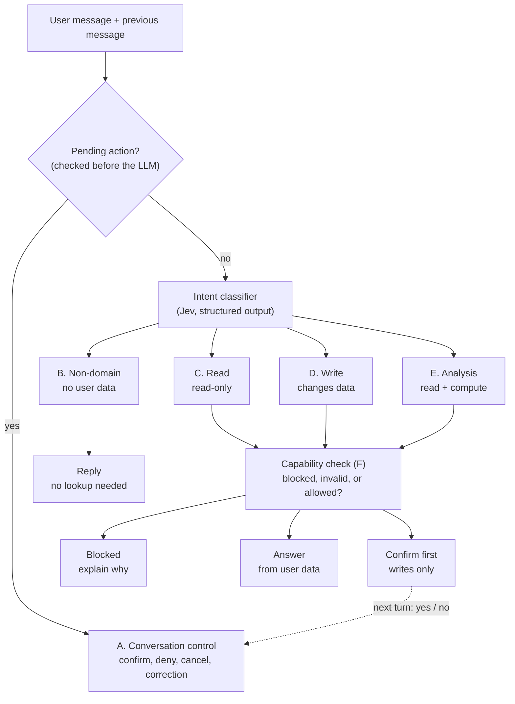
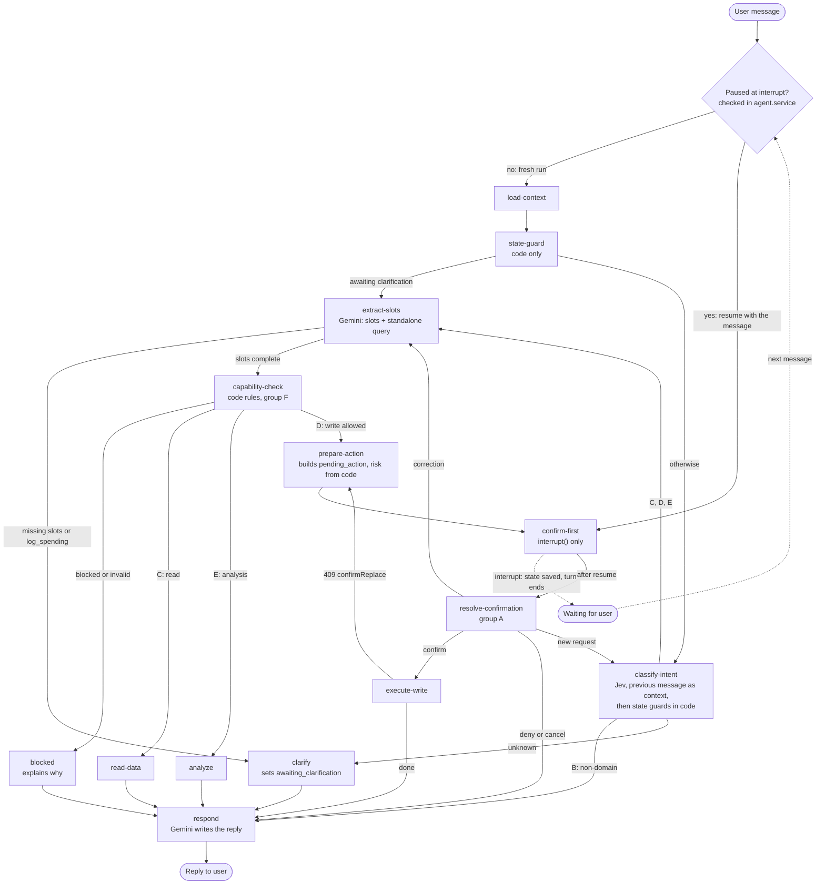
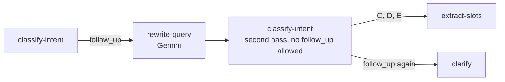

# Savvist — Chat Assistant Architecture & Implementation Status

This document details the architecture, component breakdown, and implementation status of the AI Chat Assistant module (`apps/savvist-backend/src/app/modules/chat`).

**Contents**

1. [Overview](#1-overview)
2. [Directory Structure & Implementation Status](#2-directory-structure--implementation-status)
3. [LangGraph Agent Workflow Architecture](#3-langgraph-agent-workflow-architecture)
4. [Design Decisions](#4-design-decisions)
5. [Open Points](#5-open-points)

---

## 1. Overview

The chat assistant is built on a **LangGraph state machine** integrated with **NestJS**. It uses **Jev (TypeSafe AI)** for intent classification and **Google Gemini** for slot extraction, query rewriting, and reply generation. It features durable state persistence via MongoDB checkpointers, strict policy enforcement, and an explicit human-in-the-loop confirmation workflow for write operations. It is a daily-money assistant: balances, spending, expenses, wishlist and reminders for one user. Large purchases, loans, investing, and tax or legal advice are out of scope ([4.6](#46-boundaries-and-legal-safety)).

---

## 2. Directory Structure & Implementation Status

All components under `apps/savvist-backend/src/app/modules/chat/` are implemented, except the changes marked below:

- **[TO ADD]**: a new file.
- **[TO UPDATE]**: an existing file whose behavior changes because of the decisions recorded in this document.

Details for each marked file are in [Planned changes](#planned-changes) below the tree.

```
apps/savvist-backend/src/app/modules/chat/
├── chat.module.ts                    # Root chat module importing conversations, messages, and agent
├── conversations/                    # Conversation management controllers & services
├── messages/                         # Message persistence and streaming controllers & services
└── agent/                            # AI agent domain
    ├── agent.module.ts               # Wires agent services, graph, intent classifiers, and tools
    ├── agent.service.ts              # [TO UPDATE] Entry point (`run`, `resume`, `stream`)
    ├── agent.service.spec.ts         # Unit tests for agent execution flow
    │
    ├── graph/                        # LangGraph workflow
    │   ├── agent.graph.ts            # [TO UPDATE] StateGraph builder, nodes, edges, compiled checkpointer
    │   ├── agent.state.ts            # [TO UPDATE] Graph state schema, defined with Annotation.Root
    │   ├── pending-action.schema.ts  # [TO ADD] Zod schema for pending_action
    │   ├── agent.routers.ts          # [TO UPDATE] Conditional routing functions
    │   └── nodes/                    # 14 nodes: 13 existing, plus prepare-action
    │       ├── load-context.node.ts        # [TO UPDATE] Loads profile (with time zone), date, saved memories, due-reminder count, previous context
    │       ├── state-guard.node.ts         # [TO UPDATE] Handles answers to a clarification question
    │       ├── classify-intent.node.ts     # Invokes intent classifier
    │       ├── extract-slots.node.ts       # [TO UPDATE] Gemini slot extraction. Relative dates are resolved in code
    │       ├── capability-check.node.ts    # Validates against policy and capability rules
    │       ├── clarify.node.ts             # Handles ambiguity or unknown intents
    │       ├── blocked.node.ts             # Formulates refusal messages for forbidden actions
    │       ├── read-data.node.ts           # Fetches relevant financial records
    │       ├── analyze.node.ts             # [TO UPDATE] Safe-to-spend, spending review, what-if
    │       ├── prepare-action.node.ts      # [TO ADD] Builds pending_action before the confirmation pause
    │       ├── confirm-first.node.ts       # [TO UPDATE] Calls interrupt()
    │       ├── resolve-confirmation.node.ts# [TO UPDATE] Resolves confirmation / denial / correction
    │       ├── execute-write.node.ts       # [TO UPDATE] Executes authorized write operations
    │       └── respond.node.ts             # [TO UPDATE] Gemini reply; numbers come from code only
    │
    ├── intent/                       # Intent classification subsystem
    │   ├── intent.types.ts           # [TO UPDATE] Intent groups, intents, entities, results
    │   ├── intent.taxonomy.ts        # [TO UPDATE] Intent-to-group and intent-to-entity mapping
    │   ├── risk-tier.ts              # [TO UPDATE] Code-only risk mapping. Read by prepare-action
    │   ├── state-guards.ts           # State validation guards
    │   ├── scores-to-result.ts       # Threshold evaluation for classifier scores
    │   ├── intent-classifier.interface.ts  # Classifier abstraction
    │   ├── intent-classifier.token.ts      # NestJS DI token
    │   └── classifiers/
    │       ├── jev.classifier.ts     # Primary Jev (TypeSafe AI) classifier
    │       ├── jev.client.ts         # HTTP adapter for Jev
    │       ├── jev.questions.ts      # [TO UPDATE] Typed questions per intent
    │       └── keyword.classifier.ts # Baseline keyword classifier for evaluation
    │
    ├── llm/                          # Gemini LLM integration
    │   ├── gemini.service.ts         # Core Gemini client service
    │   ├── slot-extractor.ts         # [TO UPDATE] Extracts numerical and entity slots, and relative-date phrases as structured values
    │   ├── query-rewriter.ts         # Rewrites queries for semantic retrieval
    │   ├── reply-writer.ts           # [TO UPDATE] Generates natural conversational responses
    │   └── prompts/                  # System prompts for slots, queries, and replies
    │
    ├── capability/                   # Deterministic policy rules
    │   ├── capability-check.service.ts
    │   └── rules/
    │       ├── read-only-data.rule.ts
    │       ├── future-data.rule.ts
    │       ├── account-type-lock.rule.ts
    │       ├── large-amount.rule.ts        # [TO ADD] Blocks analysis of very large amounts
    │       ├── reminder-date.rule.ts       # [TO ADD] Rejects reminder dates in the past
    │       ├── unsupported-feature.rule.ts   # [TO UPDATE] Also blocks out-of-scope topics
    │       └── policy-flag.rule.ts   # Enforces config flags for deletes & base salary changes
    │
    ├── tools/                        # Domain adapters & memory tools
    │   ├── read.tool.ts              # [TO UPDATE] Fetches balances, metrics, expenses, wishlist, reminders, logs, profile
    │   ├── write.tool.ts             # [TO UPDATE] Executes write intents (expenses, wishlist incl. swap, base salary, accounts, entry records, reminders)
    │   ├── memory.tool.ts            # [TO UPDATE] Agent memory (`agentMemories`): list, save, forget. Saves need a confirm turn
    │   └── tool-registry.ts          # Intent-to-tool mapping registry
    │
    ├── analysis/                     # [TO ADD] Pure functions, no model calls
    │   ├── safe-to-spend.ts          # [TO ADD] Safe-to-spend rules (DATABASE.md 7.1)
    │   └── resolve-relative-date.ts  # [TO ADD] "next month", "after 2 weeks" to YYYY-MM-DD in users.timeZone
    │
    ├── persistence/                  # State persistence
    │   └── mongo-checkpointer.provider.ts # [TO UPDATE] MongoDBSaver checkpointer with Mongoose connection reuse
    │
    └── eval/                         # Evaluation harness
        ├── eval-intents.ts           # Accuracy and write-boundary evaluation suites
        ├── cases.jsonl               # [TO UPDATE] Test case corpus
        └── seed-cases.ts             # Seed cases generator
```

### Planned changes

| File | Change | Details |
|---|---|---|
| `agent.service.ts` | Update | Add the ownership check, paused-thread detection from the saved state, and the pending-action expiry check before each turn (see [4.2](#42-pause-detection)) |
| `graph/agent.graph.ts` | Update | Add the `prepare-action` node, entered from `capability-check` (write allowed) and from `execute-write` (409) |
| `graph/agent.state.ts` | Update | State defined with `Annotation.Root` (`messages`, `intentResult`, `pending_action`, etc.). See [4.1](#41-state-definition-style). Also holds `spending_review` ([4.9](#49-safe-to-spend-and-spending-review)) and `dueReminderCount` ([4.7](#47-reminders-and-relative-dates)) |
| `graph/pending-action.schema.ts` | Add | Zod schema for `pending_action` (`tool`, `args`, `risk`, `createdAt`, `expiresAt`). Used by `prepare-action` and `resolve-confirmation` |
| `graph/agent.routers.ts` | Update | A write that passes `capability-check` goes to `prepare-action` |
| `nodes/state-guard.node.ts` | Update | Handles answers to a clarification question only. Paused confirmations are detected in `agent.service` |
| `nodes/prepare-action.node.ts` | Add | Builds `pending_action` from the completed slots, with risk from `risk-tier.ts` and an expiry time. Adds conflict details on the 409 loop (see [4.4](#44-prepare-action)) |
| `nodes/confirm-first.node.ts` | Update | Calls `interrupt()` only, so a restart on resume repeats nothing else |
| `nodes/resolve-confirmation.node.ts` | Update | Parses `pending_action` with its schema, treats an expired one as cancelled, then resolves confirmation / denial / correction |
| `nodes/execute-write.node.ts` | Update | Executes authorized write operations. Safe to retry. On a 409 it goes back to `prepare-action` |
| `persistence/mongo-checkpointer.provider.ts` | Update | Async provider, explicit `dbName`, `setup()` at startup (see [4.3](#43-mongodbsaver-setup)) |
| `nodes/load-context.node.ts` | Update | Also loads `users.timeZone`, saved memories and the count of due reminders ([4.7](#47-reminders-and-relative-dates), [4.10](#410-agent-memory)) |
| `nodes/extract-slots.node.ts`, `llm/slot-extractor.ts` | Update | Date phrases come back as structured values and are resolved in code. New slots: amount, span in days, set-aside per payday ([4.7](#47-reminders-and-relative-dates), [4.9](#49-safe-to-spend-and-spending-review)) |
| `nodes/analyze.node.ts` | Update | Calls `safe-to-spend.ts` and runs the spending review ([4.9](#49-safe-to-spend-and-spending-review)) |
| `nodes/respond.node.ts`, `llm/reply-writer.ts` | Update | Numbers only from code results, an estimate note on analysis answers, a due-reminder line on a new conversation ([4.6](#46-boundaries-and-legal-safety), [4.7](#47-reminders-and-relative-dates)) |
| `analysis/safe-to-spend.ts` | Add | Pure function for the rules in `DATABASE.md` section 7.1 |
| `analysis/resolve-relative-date.ts` | Add | Pure function that turns a structured date phrase into `YYYY-MM-DD` in the user's time zone |
| `capability/rules/large-amount.rule.ts` | Add | Blocks analysis of amounts above `LARGE_AMOUNT_MULTIPLE * N` ([4.6](#46-boundaries-and-legal-safety)) |
| `capability/rules/reminder-date.rule.ts` | Add | Rejects a reminder date before today in the user's time zone |
| `capability/rules/unsupported-feature.rule.ts` | Update | Also blocks out-of-scope topics ([4.6](#46-boundaries-and-legal-safety)) |
| `tools/read.tool.ts`, `tools/write.tool.ts`, `tools/memory.tool.ts` | Update | Reminders, wishlist swap, entry records, memory list, save and forget ([4.5](#45-what-the-assistant-can-do)) |
| `intent/intent.types.ts`, `intent.taxonomy.ts`, `risk-tier.ts`, `classifiers/jev.questions.ts` | Update | New intents and risk tiers ([4.5](#45-what-the-assistant-can-do)) |
| `eval/cases.jsonl` | Update | Cases for the new intents and for every blocked case in [4.6](#46-boundaries-and-legal-safety) |

---

## 3. LangGraph Agent Workflow Architecture

Two views of the same workflow. The high-level view shows the routing order for every message. The detailed view shows the LangGraph nodes, the `interrupt()` pause and the loops.

### 3.1 Decisions reflected in the workflow

- `undo_last` is dropped. "Undo that" is a blocked request (`unsupported_feature`).
- Follow-ups use **option C**: there is no `follow_up` intent. Jev receives the previous assistant message as context and picks the real intent directly. Gemini produces the standalone query together with the slots. Option B is the documented fallback (see [3.6](#36-fallback-for-follow-ups-option-b)).
- On resume, LangGraph restarts the paused node from its beginning. So `confirm-first` contains only the `interrupt()` call, and `pending_action` is built in a separate `prepare-action` node before it.
- Reminders, the wishlist swap, safe-to-spend, the spending review and agent memory add no new graph nodes. They use the existing path ([4.5](#45-what-the-assistant-can-do) to [4.10](#410-agent-memory)).

### 3.2 High-level routing



### 3.3 Detailed LangGraph workflow



### 3.4 How the two main diagrams relate

| High-level | Detailed |
|---|---|
| Pending action check | Split in two: `agent.service` checks for a paused interrupt, and `state-guard` handles answers to a clarification question |
| A. Conversation control | Split across `state-guard` (clarification answers) and `resolve-confirmation` (`confirm`, `deny`, `cancel`, `correction`). There is no `follow_up` or `undo_last` intent |
| Intent classifier | `classify-intent` (Jev, with the previous message as context), plus `extract-slots` (Gemini) for slots and the standalone query |
| Capability check (F) | `capability-check`, with code-only rules |
| Answer | `read-data` and `analyze` |
| Confirm first | `prepare-action` (builds `pending_action`) then `confirm-first` (calls `interrupt()`) |
| Next turn: yes / no | The dotted loop through `Waiting for user` and the `Entry` check |

### 3.5 Additions in the detailed view

These appear in the detailed view only, not in the high-level one:

- `clarify` for `unknown` intents and missing slots, including `log_spending`.
- `prepare-action`, so that nothing but the `interrupt()` call runs again when a paused node restarts on resume.
- A `correction` loop back to `extract-slots`, so changed parameters pass the capability check again (for example, a corrected date that turns out to be in the future).
- A "new request" loop back to `classify-intent` when the user ignores the pending question.
- A 409 `confirmReplace` loop from `execute-write` back to `prepare-action`.

### 3.6 Fallback for follow-ups (option B)

Use only if the eval shows Jev cannot reliably resolve follow-ups from the previous message (option C). It reintroduces `follow_up` as an intent in group A and adds a `rewrite-query` node. A state flag (`rewriteAttempted`) stops loops: the second pass may not return `follow_up`, and if it does, the message goes to `clarify`.



---

## 4. Design Decisions

### 4.1 State definition style

The graph state in `agent.state.ts` is defined with `Annotation.Root`. `StateSchema` and Zod object schemas are also accepted by `StateGraph`, so this is a choice rather than a constraint.

**Why `Annotation.Root`**

- The LangGraph JS docs recommend it for new graphs. `StateSchema` (announced December 2025) is an additional schema-first option, and the existing Annotation API continues to work unchanged.
- The checkpointer, state snapshots and most LangGraph examples assume it, which lowers risk while other points here (pause detection, `MongoDBSaver`) depend on library behavior.
- The state is mostly plain fields: `messages` with a reducer, `intentResult`, `pending_action`, `awaiting_clarification` and `rewriteAttempted`. It does not need schema-first features.
- Zod-based state has shown type friction. One LangGraph docs change moved a quickstart from Zod to Annotation to fix type incompatibilities.

**Runtime validation for `pending_action`**

`pending_action` is saved to Mongo and read back on a later turn, possibly after a deploy. Validate it at that boundary without changing the state style:

- Define a separate Zod schema for `pending_action`.
- Parse the value when `resolve-confirmation` reads it.
- If parsing fails, treat the action as cancelled and tell the user. A malformed or outdated action must never reach `execute-write`.

**When to revisit**

Switch to `StateSchema` only if the project wants the state type and runtime validation from a single definition, and is already on Zod 4 or another Standard Schema library. Check the installed `@langchain/langgraph` and Zod versions first.

### 4.2 Pause detection

The `Entry` check in the detailed diagram is answered in `agent.service`, before the graph is invoked, by reading the saved thread state. It is not a graph node.

**How it works**

- At the start of every turn, `agent.service` asks the graph for the saved state snapshot of the thread (`getState` with the `thread_id`). This works at any time because the checkpointer persists the state, not only right after an `invoke`.
- The snapshot has a `next` list (nodes that will run next) and a `tasks` list. Each task carries an `interrupts` list.
- The thread is paused when any task has a non-empty `interrupts` list. This is the primary test, because `next` can also be non-empty after a crash or a failed node, which is not a real pause.
- Fallback if the installed version lacks `interrupts` on tasks: treat the thread as paused when `next` contains `confirm-first`.

**Routing after the check**

- Paused: resume the graph with the user's message as the resume value. `interrupt()` inside `confirm-first` returns that message, and the graph continues to `resolve-confirmation`.
- Not paused: start a fresh run with the user's message, beginning at `load-context`.
- The same check and the same two paths apply to `run`, `resume` and `stream`.

**Rules that go with it**

- **Ownership first.** The thread has no `userId` of its own. Check that the conversation belongs to the user before reading the saved state or invoking the graph (`DATABASE.md` section 4.10).
- **Expiry.** `pending_action` carries an `expiresAt` (`DATABASE.md` section 4.8). If it has passed, treat the action as cancelled and start a fresh run instead of resuming. The `resolve-confirmation` "new request" branch already covers a user who ignores the pending question.
- **Concurrency.** Two messages on the same thread can both see the thread as paused. Serialize turns per thread with a lock or queue.
- **Clarification is separate.** `awaiting_clarification` is ordinary graph state, not an interrupt, so the snapshot check does not detect it. `state-guard` keeps reading it from the loaded state.
- **Persistence dependency.** Detection only works if checkpoints persist across requests, so test it against the real `MongoDBSaver` (see [4.3](#43-mongodbsaver-setup)).

### 4.3 MongoDBSaver setup

The checkpointer is `MongoDBSaver` from `@langchain/langgraph-checkpoint-mongodb`. It is installed together with the `mongodb` driver. The collection design and rules are in `DATABASE.md` section 4.10, and this section is the implementation checklist for `mongo-checkpointer.provider.ts`.

**Setup**

- The constructor takes an options object with a required `client` and optional `dbName`, `checkpointCollectionName`, `checkpointWritesCollectionName` and `enableTimestamps`. MongoDB's own integration page still shows the older form that passes the client alone, so follow the LangChain docs.
- There is no connection-string helper. Build a `MongoClient` (or reuse Mongoose's), construct the saver, and call `setup()` once at startup so the indexes exist.
- Keep the default collection names, `checkpoints` and `checkpoint_writes`. Application code never writes to them.
- Set `dbName` explicitly, to the same database the app uses, so checkpoints don't land in an unexpected database.

**Reusing the Mongoose connection**

- Mongoose's `connection.getClient()` returns the `MongoClient` behind its connection. Build the saver in an async provider that injects the Mongoose connection and waits until it is ready.
- Never close that client from the saver. Mongoose owns it.
- Mongoose bundles its own `mongodb` driver. If its version differs from the one the checkpointer depends on, the two `MongoClient` types can be reported as incompatible. Run `npm ls mongodb` after installing and align the versions. Cast only as a last resort.
- Fallback: open a second `MongoClient` with the same connection string.

**State size**

- LangGraph writes a checkpoint at every super-step, not once per user message, so a single conversation produces many checkpoints.
- A MongoDB checkpoint is limited to one 16 MB document. Keep graph state small: store IDs and arguments, not query results, and use only plain serializable values.

**Retention**

- `DATABASE.md` proposes a `ttl` option on the saver. This could not be confirmed for the JavaScript saver. The Python saver has one, the JavaScript parameters reference lists `enableTimestamps` instead, and the TTL configuration in the JavaScript package belongs to `MongoDBStore`, not the saver.
- First check whether the installed saver accepts a `ttl` option. If it does, use it as `DATABASE.md` describes.
- If it does not, turn on `enableTimestamps`, which adds an `upserted_at` date on each write, and create a TTL index on that field for both collections in the provider. This conflicts with the "no custom indexes" line in `DATABASE.md` section 4.10, so update that document if the fallback is used.
- TTL ages out individual checkpoints, so an idle conversation can lose its agent memory. `messages` keeps the visible history, and `pending_action` has its own shorter `expiresAt`.

**Deleting a conversation**

- `deleteThread(threadId)` removes a thread's checkpoints and writes. Only the conversation delete endpoint calls it, after the transaction that deletes the conversation and its messages. It may use a different client, so it cannot join that transaction. Make it idempotent and safe to retry.

**Test before relying on it**

- Restart simulation: run a turn to `interrupt()`, build a fresh graph and saver as if the server restarted, confirm the pause is still detected, then resume and confirm the graph reaches `resolve-confirmation`.
- Ownership: confirm that a user cannot read or resume another user's thread.
- Deletion: confirm that `deleteThread` leaves no documents for that thread in either collection.

### 4.4 prepare-action

`prepare-action` is a separate node between `capability-check` and `confirm-first`. `pending_action` is not built at the end of `capability-check`.

**Why a separate node**

- On resume, LangGraph restarts the paused node from its beginning. If `confirm-first` built the action, that work would run again. A separate node runs once, and a checkpoint is saved after it, so `pending_action` is stored before the pause.
- The 409 `confirmReplace` loop needs a node to return to that rebuilds `pending_action` with the conflict details, which become a second confirm step (`DATABASE.md` sections 4.8 and 4.10). If the action were built in `capability-check`, that loop would have to re-run every policy rule or duplicate the building logic.
- `capability-check` stays a pure policy gate that decides allowed, blocked or invalid. Building an action is a different job with different tests.
- Risk is derived in code only, from `risk-tier.ts`, never from the model.

**What the node does**

- Input: a write intent whose slots are complete and that passed `capability-check`.
- Output: `pending_action` with `tool`, `args`, `risk`, `createdAt` and `expiresAt` (`DATABASE.md` section 4.8).
- Values are plain and serializable: IDs and arguments, dates as `YYYY-MM-DD` strings, no `Date` instances or class objects (`DATABASE.md` section 4.10).
- The result is checked against `pending-action.schema.ts` before it is saved to state.
- The expiry window comes from configuration and should be shorter than the checkpoint retention period.
- No model call and no data reads or writes. It is pure code.
- On the 409 path it also stores the conflict details (existing and proposed balances) in `pending_action`.
- The confirmation text shown to the user is produced from `pending_action` and saved as a normal assistant message (`DATABASE.md` section 4.8).

**Edges**

- `capability-check` (write allowed) to `prepare-action`, then to `confirm-first`.
- `execute-write` (409 `confirmReplace`) to `prepare-action`, then to `confirm-first`.
- A `correction` from `resolve-confirmation` goes back through `extract-slots` and `capability-check`, so it also reaches `prepare-action` and the pending action is rebuilt with the corrected values.

**Tests to add**

- Risk comes from `risk-tier.ts` for every write intent.
- `expiresAt` is set from the configured window.
- The schema rejects a malformed action.
- The 409 path includes the conflict details.
- After the correction loop, the rebuilt `pending_action` has the corrected values.

### 4.5 What the assistant can do

The assistant handles day-to-day money for one user. Intent names are illustrative; the final names live in `intent.types.ts`. Nothing here needs a new graph node.

| Capability | Group | Confirm first | Notes |
|---|---|---|---|
| Read balances, Total Fund, Actual Cash, Health, Growth, Today's Allowance and the 30-day trend, and explain any of them | C | no | Values come from `read.tool.ts`, never from the model |
| Read expenses (month total, what is due before the next payday), wishlist (pending total, next by priority), record logs, reminders, profile | C | no | Record logs are read-only |
| Update base salary and employment status | D | yes | Unemployed forces salary 0. Logged. Subject to `policy-flag.rule.ts` |
| Account entries: create, rename, delete | D | yes | Type cannot change once the account has records. Delete archives when records exist |
| Entry records: save a day's balance, change the amount, delete a day | D | yes, and again before replacing an existing balance | No future days. Only the amount changes, never the account type |
| Expenses: create, edit, delete | D | yes | |
| Wishlist: create, edit, delete, mark purchased, undo purchase | D | yes | |
| Wishlist: swap priority levels | D | yes, one confirmation | [4.8](#48-wishlist-priority-swap) |
| Reminders: create, edit, complete, delete (money owed to the user, expected payments, custom) | D | yes | [4.7](#47-reminders-and-relative-dates) |
| Memory: list, save, forget | C and D | save and forget need a yes | [4.10](#410-agent-memory) |
| Can I afford this now or next month? When can I safely buy it? (a Wishlist item or any amount) | E | no | [4.9](#49-safe-to-spend-and-spending-review) |
| Is spending this amount over a few days (a weekend) safe? What is the safe range? | E | no | [4.9](#49-safe-to-spend-and-spending-review) |
| When will I have this amount in my account? | E | no | An estimate with stated assumptions |
| Am I spending too much? Help me lessen it | E | no | Several questions, conversational only ([4.9](#49-safe-to-spend-and-spending-review)) |
| What-if: how does a new expense change my allowance? | E | no | |
| Greetings, "what can you do?" | B | no | No data lookup |

Risk tiers (code only, in `risk-tier.ts`). This is a proposal to reconcile with the existing file:

| Tier | Intents |
|---|---|
| low | reminders (create, edit, complete, delete), memory save and forget, wishlist swap, mark purchased, undo purchase |
| medium | create or edit an expense, wishlist item, account or daily balance |
| high | any delete of an expense, wishlist item, account or daily balance, replacing an existing balance, base salary, employment status |

### 4.6 Boundaries and legal safety

The assistant covers daily money only. The `blocked` node explains the reason in one or two sentences and says what it can do instead.

| Request | Blocked by |
|---|---|
| Property, vehicles, loans, mortgages, business funding, investing, crypto, stocks, insurance products | `unsupported-feature.rule.ts` (out-of-scope intent) |
| Tax, legal or investment advice | `unsupported-feature.rule.ts` |
| How to pressure, threaten or take legal action against a borrower, or hide a debt | `unsupported-feature.rule.ts` |
| Affordability, "when", or what-if for a very large amount | `large-amount.rule.ts` |
| "Undo that" | `unsupported-feature.rule.ts` |
| A balance dated in the future | `future-data.rule.ts` |
| Changing an account's type after it has records | `account-type-lock.rule.ts` |
| Editing or deleting record logs | `read-only-data.rule.ts` |
| Renaming or deleting a conversation, changing the time zone | `unsupported-feature.rule.ts` |

- **Large amounts.** `large-amount.rule.ts` blocks the analysis intents when the amount is above `LARGE_AMOUNT_MULTIPLE * N`, where N is the net income from `DATABASE.md` section 7. `LARGE_AMOUNT_MULTIPLE = 6` is a placeholder. It does not block recording data, so the user can still save a large wishlist item. If N is 0 the rule is skipped, and `DATABASE.md` 7.1 already answers "not safe".
- **Estimates, not advice.** Every analysis answer states that it is an estimate from the user's own entries and not financial, tax or legal advice. `reply-writer.ts` adds that line.
- **Numbers come from code.** Gemini writes the reply from a result object and never calculates or invents a figure.
- **Stale data.** If balances are older than `STALE_DAYS`, the answer says so first (`DATABASE.md` 7.1).
- **Other people's data.** Only a first name or label is stored for a borrower or a payer. No contact details.

### 4.7 Reminders and relative dates

Reminders use the existing write path: `extract-slots`, `capability-check`, `prepare-action`, `confirm-first`, `execute-write` (`DATABASE.md` 4.11).

- **Kinds.** "Someone borrowed X" becomes `collect_debt` with the amount and the name. "I'm expecting a payment on a date" becomes `expected_income`. Anything else is `custom`.
- **Dates are resolved in code.** Gemini returns an exact date or a structured phrase: a unit (day, week or month), a number n, or "next month". `resolve-relative-date.ts` computes the date in `users.timeZone`, which `load-context` provides, using the rules in `DATABASE.md` 4.11. A vague phrase ("soon") goes to `clarify`.
- **Past dates.** `reminder-date.rule.ts` rejects a date before today. Today is allowed. This is the reverse of `future-data.rule.ts`, which applies to balances.
- **Confirmation shows the exact date,** for example "Remind you on 2026-12-04 to ask Juan for 2000?".
- **Reminders do not move money.** An unpaid debt or an expected payment is never counted in balances or the allowance. When the user says the money arrived, the assistant offers to mark the reminder done and, as a separate confirmed write, to update the balance.
- **Delivery is in-app only.** `load-context` puts only the count of due and overdue reminders in graph state (`dueReminderCount`). `respond` adds one line on the first message of a new conversation, and `read-data` answers "what reminders do I have". No push or email.

### 4.8 Wishlist priority swap

- Intent `swap_wishlist_priority`. The user names two items, or says "make X the priority item". An ambiguous item name goes to `clarify`.
- Only one pending item can hold `priority` (`DATABASE.md` 4.5). When the user sets another item to `priority` and the slot is taken, `execute-write` gets the 409 that names the holder. It goes back to `prepare-action`, which builds a swap: the target takes `priority` and the holder takes the level the target had. This is the same loop as `confirmReplace`, with no new edge.
- `pending_action` is one action: `tool: swapWishlistPriority`, `args` holding both item ids with their current and new levels. The confirmation text shows both items before and after. The user confirms once, and both changes apply in one transaction or neither does.
- Undoing a purchase into a taken `priority` slot uses the same 409 and the same swap.

### 4.9 Safe-to-spend and spending review

**Safe-to-spend.** The rules are in `DATABASE.md` 7.1 and live in `analysis/safe-to-spend.ts`.

- `read-data` fetches what the function needs (base salary, payday dates, Actual Cash, Total Fund, expenses, latest balance day). `analyze` calls the function. Gemini only words the reply.
- The result is a small plain object: verdict (`safe`, `tight` or `not_safe`), S, the allowance, the allowance after the purchase, the safe range or the earliest payday, the assumptions, and a stale flag. Only that object goes into graph state.
- Intents: `check_affordability` (now), `check_spending_range` (a number of days), `estimate_when_available`. "Can I afford it next month?" is evaluated at the first payday of next month, using the same pool calculation as "when".
- The amount comes from a Wishlist item (looked up in `read-data`) or from a number the user gives.

**Spending review** ("am I spending too much?").

- Intent `spending_review`. State field `spending_review` holds the questions asked and the answers, as plain values (small).
- `clarify` asks one question per turn, and `state-guard` sends each answer back to `extract-slots`. Questions cover normal daily spending: meals and food per day, transport per day, load, data and subscriptions per month, groceries and household per week, leisure, going out and shopping per week. Already answered questions are skipped.
- `MAX_REVIEW_QUESTIONS = 5`. After the last answer, or when the user stops answering, `analyze` runs with what it has and says what was missing.
- The answers are turned into a daily figure and compared with Today's Allowance. At or below it: within budget. Above it: over by the gap. When over, the assistant suggests at most three trims, starting with the largest category, aimed at bringing the daily figure down to the allowance. These are options, not orders.
- **Conversational only.** The answers stay in the thread's agent memory and are not written to any collection (`DATABASE.md` 4.8). A user can ask the assistant to remember a habit, which goes through [4.10](#410-agent-memory).
- `log_spending` ("I spent 200 on lunch") stays routed to `clarify`. Nothing is saved.

### 4.10 Agent memory

- `memory.tool.ts` offers `listMemory`, `saveMemory` and `forgetMemory` over `agentMemories` (`DATABASE.md` 4.12).
- `load-context` reads the memories (at most 50) each turn and passes them to the prompts as quoted data, never as instructions. They are not stored in graph state.
- Saving and forgetting go through the normal confirm turn at the low risk tier. Nothing is saved automatically. The assistant may offer to remember a habit or preference the user stated.
- Code checks a save before `prepare-action`: the key format, a value of at most 300 characters, and no value that looks like a password or a long digit string such as an account or card number. A rejected save is explained to the user.
- Balances, salary, expenses and other data that already exist in collections are never saved as memories.

---

## 5. Open Points

- **Pause detection: design resolved, version check pending.** See [4.2](#42-pause-detection). Before building it, confirm in the installed `@langchain/langgraph` version that task snapshots expose an `interrupts` list. If they don't, use the `next` list as the fallback test.
- **State definition style: decided.** See [4.1](#41-state-definition-style). Use `Annotation.Root` for `agent.state.ts`.
- **MongoDBSaver: design agreed, install-time checks pending.** See [4.3](#43-mongodbsaver-setup) and `DATABASE.md` section 4.10. Still to confirm after install: the single `mongodb` driver version, `getClient()` on the installed Mongoose version, and whether the saver has a `ttl` option (see Retention in 4.3).
- **`prepare-action`: decided.** See [4.4](#44-prepare-action). It stays a separate node and is now in the scaffold.
- **Option C is untested.** Add follow-up cases to `cases.jsonl` (for example "What about last month?" after different assistant answers) and compare against option B.
- **Large-amount threshold is a placeholder.** `LARGE_AMOUNT_MULTIPLE = 6` in [4.6](#46-boundaries-and-legal-safety) needs a final value.
- **Risk tiers are proposed.** Reconcile the table in [4.5](#45-what-the-assistant-can-do) with the existing `risk-tier.ts`.
- **New intents need classifier coverage.** Add typed questions in `jev.questions.ts` and cases in `cases.jsonl` for reminder phrasings, the swap, safe-to-spend boundaries, out-of-scope topics, large amounts and memory refusals.
- **Push or email reminders are deferred.** They need a scheduler (`DATABASE.md` section 12).