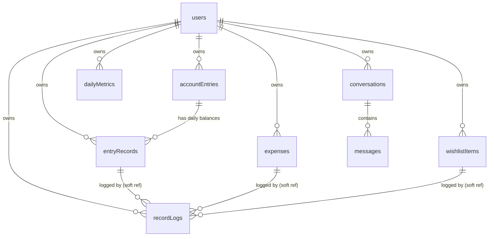

# DATABASE.md — Savvist MongoDB Architecture

Database design for the Savvist personal finance tracker (NestJS + Mongoose + MongoDB). It is derived from the wireframes and the frontend plan in `PROJECT DESCRIPTION.md` and `Task.md`. Items marked **[DECIDE]** are open questions where I made an assumption you should confirm.

**Revision note:** money sources are now modeled as two collections. `accountEntries` holds the accounts (BDO, BPI, GCash), which are created once. `entryRecords` holds the balance of each account for each day.

**Revision note 2:** the backend stack is NestJS 11 with Mongoose (this document previously said Express). The answers recorded in section 12 are now applied in sections 2, 4, 6, 7, 8 and 10. Questions that are still unanswered are listed under "Still open" at the end of section 12.

**Revision note 3:** `monthlySummaries` is removed. Total Fund, Actual Cash, Health and Growth are now saved once per day in `dailyMetrics` (4.9). Section 7 now holds the expense rule, the meaning of the 15%, 20% and 3x constants, the zero rules, and the payday rule. Base salary changes are logged in `recordLogs` (4.6). The Angular layer maps `_id` to `id` (section 10).

**Revision note 4:** Health and Growth are capped at 100% as well as floored at 0. Changes to expenses, base salary or `isUnemployed` do not recompute `dailyMetrics`, and neither do back-dated balances or deleted day records, so each row is a snapshot as saved. The payday rule, the Growth fallback and the final-values-only clamp are confirmed.

---

## 1. Design principles

1. **Every document belongs to a user.** The wireframe says "Welcome User A", and the app may grow to several users. Every collection except `users` carries a `userId`, every query filters by it, and every index starts with it. Adding authentication later then needs no schema change. The app is single-user for now (section 12, Q7), so the backend uses one configured user until authentication exists.
2. **Separate "what exists" from "what happened".** Accounts are slow-changing definitions (saved once). Daily balances are time-series facts (one per account per day). They live in different collections.
3. **Store only what cannot be derived, with one exception.** Total Fund, Actual Cash, Health and Growth are saved once per day in `dailyMetrics` (4.9). Today's Allowance, current balances and the footer totals are computed from other collections (section 7).
4. **Money is stored as direct numbers** (e.g., PHP 1,000.50 is stored as `100050` or `1000.50` directly). The API sends and receives direct numeric values.
5. **Calendar days are stored as `YYYY-MM-DD` strings** (the user's local day, Asia/Manila). Moments in time are BSON `Date` in UTC. A daily balance belongs to a calendar day, and a UTC midnight timestamp would land on 8:00 AM Manila time and cause off-by-one-day bugs.
6. **Embed what is always read together and stays small. Reference what grows without bound.** Chat messages and daily balances are therefore their own collections.
7. **Record logs are append-only and self-contained.** They snapshot the name and amount at the time of the event, so they stay correct if the source is later edited or deleted.
8. **Field naming:** camelCase fields, plural camelCase collection names, `_id` as `ObjectId`, enums as lowercase strings.

## 2. Collections at a glance

| Collection | Source in the UI | Purpose |
|---|---|---|
| `users` | top bar, Base Salary dialog, welcome message | Profile, base salary, unemployed flag |
| `accountEntries` | Add Amounts dialog, "+ Create New Entry" | The user's accounts (BDO, BPI, GCash). Saved once. |
| `entryRecords` | Add Amounts dialog, amount inputs | Balance of each account for each day |
| `expenses` | Expenses page and dialog | Recurring or month-specific expenses |
| `wishlistItems` | Wishlist page and dialog | Planned purchases with priority and status |
| `recordLogs` | Record Logs page | Append-only audit trail of every financial event |
| `conversations` | Chat right panel | Saved chat threads |
| `messages` | Chat thread | Individual chat messages |
| `dailyMetrics` | Dashboard cards, gauges and line chart | Saved Total Fund, Actual Cash, Health and Growth, one row per day |

## 3. Relationships



- Hard references (always valid): everything points to `users._id` through `userId`. `entryRecords` point to `accountEntries._id`. `messages` point to `conversations._id`.
- Soft references: `recordLogs.sourceId` points to the record that caused the log and may dangle after deletion. That is intended, because the log is a historical snapshot.

---

## 4. Collection schemas

### 4.1 `users`

| Field | Type | Required | Notes |
|---|---|---|---|
| `_id` | ObjectId | yes | |
| `displayName` | string | yes | Shown in "Welcome User A". 1 to 60 chars. |
| `email` | string | no | Required once authentication is added. Lowercased, unique. |
| `passwordHash` | string | no | Future. Never returned by the API. |
| `baseSalary` | number | yes | `>= 0`. The exact base salary amount. Forced to `0` when `isUnemployed` is true. |
| `salaryDay1` | int | no | 1 to 31. First salary day of the month (e.g., 15). |
| `salaryDay2` | int | no | 1 to 31. Second salary day of the month, if applicable (e.g., 30). |
| `isUnemployed` | bool | yes | Default `false`. Mirrors the "Currently unemployed" checkbox. |
| `currency` | string | yes | Default `"PHP"`. |
| `locale` | string | yes | Default `"en-PH"`. |
| `timeZone` | string | yes | Default `"Asia/Manila"`. Decides what "today" means for daily balances. |
| `createdAt`, `updatedAt` | Date | yes | |

Example:

```json
{
  "_id": "665f1c2a9b1e8a0012a1b001",
  "displayName": "User A",
  "baseSalary": 30000,
  "salaryDay1": 15,
  "salaryDay2": 30,
  "isUnemployed": false,
  "currency": "PHP",
  "locale": "en-PH",
  "timeZone": "Asia/Manila",
  "createdAt": "2026-10-23T02:00:00.000Z",
  "updatedAt": "2026-10-23T02:00:00.000Z"
}
```

Rules:
- `baseSalary` and `isUnemployed` are updated together. The server enforces "unemployed means salary 0".
- Base salary is a single value on the user document. It is not recorded repeatedly and does not generate monthly income (section 12, Q3).
- The profile is embedded in the user document because it is one record read on every page load.

### 4.2 `accountEntries` (accounts, saved once)

Created from "+ Create New Entry" in the Add Amounts dialog: an entry name such as "BDO", "BPI" or "GCash", plus an entry type.

| Field | Type | Required | Notes |
|---|---|---|---|
| `_id` | ObjectId | yes | |
| `userId` | ObjectId | yes | |
| `name` | string | yes | 1 to 60 chars. Unique per user, case-insensitive. |
| `type` | string enum | yes | `cash`, `credit`, `savings`. The wireframe's dropdown defaults to "Cash Amount". |
| `archivedAt` | Date | no | Set instead of deleting when the account already has daily balances (section 9). |
| `sortOrder` | int | no | Optional manual ordering in the dialog. Falls back to `createdAt`. |
| `createdAt`, `updatedAt` | Date | yes | |

Example:

```json
{
  "_id": "665f1c2a9b1e8a0012a1c001",
  "userId": "665f1c2a9b1e8a0012a1b001",
  "name": "BDO Debit",
  "type": "cash",
  "createdAt": "2026-10-23T02:05:00.000Z",
  "updatedAt": "2026-10-23T02:05:00.000Z"
}
```

Rules:
- An account holds **no balance**. Balances live in `entryRecords`.
- Renaming an account updates only this document. Historical `entryRecords` keep a snapshot of the old name (see 4.3).
- For `credit` accounts, the balance stored in `entryRecords` is the **amount owed** (a positive number). It is a liability: it is subtracted when computing Total Fund and is never counted as cash.
- `type` is **locked** once any `entryRecords` exist for the account (section 12, Q2), because changing it would change how past totals are interpreted. The service rejects a type change after the first record. The name can still be edited.

### 4.3 `entryRecords` (daily balances per account)

One document per account per calendar day. This is what the user fills in every day in the Add Amounts dialog.

| Field | Type | Required | Notes |
|---|---|---|---|
| `_id` | ObjectId | yes | |
| `userId` | ObjectId | yes | |
| `accountEntryId` | ObjectId | yes | Reference to `accountEntries._id`. |
| `day` | string | yes | Calendar day, `YYYY-MM-DD`, in the user's time zone. |
| `balance` | number | yes | `>= 0`. The account balance on that day. |
| `accountName` | string | yes | Snapshot of the account name when recorded. |
| `accountType` | string enum | yes | Snapshot of the type (`cash`, `credit`, `savings`). |
| `createdAt`, `updatedAt` | Date | yes | |

Example:

```json
{
  "_id": "665f1c2a9b1e8a0012a1c101",
  "userId": "665f1c2a9b1e8a0012a1b001",
  "accountEntryId": "665f1c2a9b1e8a0012a1c001",
  "day": "2026-10-23",
  "balance": 1500000,
  "accountName": "BDO Debit",
  "accountType": "cash",
  "createdAt": "2026-10-23T02:10:00.000Z",
  "updatedAt": "2026-10-23T02:10:00.000Z"
}
```

Rules:
- **Unique on `(userId, accountEntryId, day)`.** Saving again on the same day **overwrites** that day's balance (an upsert), never creates a second record. Each overwrite is logged in `recordLogs`.
- **Missing days are not stored.** If the user skips a day, the balance carries forward from the most recent earlier record. This is derived when reading, so no filler documents are written.
- **Current balance of an account** = its record with the latest `day`.
- **Back-dating is allowed.** The user can enter or correct the balance for any past day. **Future days are rejected** (confirmed). "Future" is judged against today's date in the user's time zone.
- **Replacement detection.** If a record already exists for that account and day, saving a different balance replaces it. The user must be told first: the UI shows a warning on each affected row (old balance and new balance), and the **server enforces it too**: the bulk save returns a conflict listing the existing balances that would be replaced, and only applies the change when the request carries an explicit confirmation (section 10). Saving the same value as the existing balance is a no-op.
- **Effect on derived values.** Because missing days carry forward, changing a past balance changes every later day until that account's next record. Current balances stay derived. The saved `dailyMetrics` rows for later days are not recomputed (section 4.9).
- The snapshot fields (`accountName`, `accountType`) mean charts and history do not need a join and stay correct after renames or archiving.
- The Add Amounts dialog works like this: the user picks a day (default today, past days allowed, future days disabled). The dialog lists the user's non-archived accounts, prefills each input with that day's record if one exists (otherwise the last known balance), highlights rows whose save would replace an existing balance, and Save upserts that day's records in one request after the user confirms any replacements.

**Optional optimization:** store `latestBalance` and `latestDay` on `accountEntries` to avoid an aggregation for the dashboard cards. It adds a write on every save and must stay consistent with back-dated edits, so skip it until the aggregation is measurably slow.

### 4.4 `expenses`

| Field | Type | Required | Notes |
|---|---|---|---|
| `_id` | ObjectId | yes | |
| `userId` | ObjectId | yes | |
| `name` | string | yes | 1 to 80 chars. |
| `amount` | number | yes | `> 0`. |
| `dayOfMonth` | int | yes | 1 to 31. Shown as "21st". |
| `months` | array of int | yes | Each value 1 to 12, no duplicates. **Empty array = every month.** Non-empty = only those months. |
| `createdAt`, `updatedAt` | Date | yes | |

Example, a monthly expense and a month-specific one:

```json
{ "name": "Internet", "amount": 150000, "dayOfMonth": 21, "months": [] }
{ "name": "Insurance", "amount": 600000, "dayOfMonth": 5, "months": [1, 12] }
```

Rules:
- The recurrence badge is derived from `months.length > 0`. No stored boolean, so the two can never disagree.
- Validation: `months` entries are unique integers 1 to 12. `dayOfMonth` must exist in at least one chosen month (31 with only `[2]` is rejected). For months shorter than `dayOfMonth`, the expense is due on the month's last day. This must match the frontend rule.
- Months are stored as numbers, and the frontend maps them to labels.

### 4.5 `wishlistItems`

| Field | Type | Required | Notes |
|---|---|---|---|
| `_id` | ObjectId | yes | |
| `userId` | ObjectId | yes | |
| `name` | string | yes | 1 to 80 chars. |
| `amount` | number | yes | `> 0`. |
| `priority` | string enum | yes | `asap`, `priority`, `important`, `normal`, `peripheral` (listed in sort order, highest first). Default `normal`. |
| `status` | string enum | yes | `pending` or `purchased`. Default `pending`. |
| `purchasedAt` | Date | no | Set when status becomes `purchased`. Cleared on undo. |
| `createdAt`, `updatedAt` | Date | yes | |

Example:

```json
{
  "_id": "665f1c2a9b1e8a0012a1d001",
  "userId": "665f1c2a9b1e8a0012a1b001",
  "name": "Mechanical keyboard",
  "amount": 450000,
  "priority": "important",
  "status": "pending",
  "createdAt": "2026-10-23T02:10:00.000Z",
  "updatedAt": "2026-10-23T02:10:00.000Z"
}
```

Notes:
- The "Wishlist Type" dropdown and the inline pill both edit `priority`.
- Sort order is ASAP, Priority, Important, Normal, Peripheral (confirmed, section 12, Q6). It is applied in the application (lists are small). If you need it in a query, add a numeric `priorityRank`.
- Checking an item marks it `purchased` and writes a `recordLogs` entry in the same transaction (section 8).

### 4.6 `recordLogs`

Append-only. The Record Logs page shows Name, Amount, Record Type and Date.

| Field | Type | Required | Notes |
|---|---|---|---|
| `_id` | ObjectId | yes | |
| `userId` | ObjectId | yes | |
| `name` | string | yes | Snapshot of the source name, or a description such as "Base salary updated". |
| `amount` | number | yes | Snapshot of the amount (balance, expense or price) for this event. |
| `recordType` | string enum | yes | `expense`, `cash`, `savings`, `credit`, `wishlist`. |
| `action` | string enum | yes | `created`, `updated`, `deleted`, `purchased`, `adjusted`. |
| `date` | Date | yes | When the event happened. Defaults to now. |
| `sourceCollection` | string | no | `accountEntries`, `entryRecords`, `expenses`, `wishlistItems`, `users`. |
| `sourceId` | ObjectId | no | Soft reference to the source document. |
| `previousAmount` | number | no | For overwrites (`action = updated`): the balance that was replaced. Lets the log show "replaced X with Y". |
| `effectiveDay` | string | no | For daily balances: the calendar day (`YYYY-MM-DD`) the balance belongs to. Differs from `date` when a past day was back-dated. |
| `createdAt` | Date | yes | No `updatedAt`, because logs never change. |

Example, a daily balance saved:

```json
{
  "_id": "665f1c2a9b1e8a0012a1e001",
  "userId": "665f1c2a9b1e8a0012a1b001",
  "name": "BDO Debit",
  "amount": 1500000,
  "recordType": "cash",
  "action": "created",
  "date": "2026-10-23T02:10:00.000Z",
  "sourceCollection": "entryRecords",
  "sourceId": "665f1c2a9b1e8a0012a1c101",
  "createdAt": "2026-10-23T02:10:00.000Z"
}
```

Rules:
- The API exposes **no update or delete** for this collection. Writes come only from other modules' service code.
- Events that produce a log:
  - daily balance saved (`recordType` is the account's type: `cash`, `credit` or `savings`; `action` is `created` for the first record of the day and `updated` for an overwrite, which also stores `previousAmount` and `effectiveDay`);
  - expense created, updated or deleted (`expense`);
  - wishlist item purchased (`wishlist`);
  - base salary set or changed, including the forced change to 0 when the user becomes unemployed. There is no separate `salary` type (section 12, Q5), so the log uses `recordType = cash`, `name = "Base salary updated"`, `amount` = the new salary, `previousAmount` = the old salary, and `sourceCollection = users`. `action` is `created` the first time the salary is set and `updated` after that.
- Creating an account (`accountEntries`) does not need a log. Its first daily balance does.
- Only write a log when the balance actually changed, so re-saving an unchanged dialog does not flood the table.

### 4.7 `conversations`

| Field | Type | Required | Notes |
|---|---|---|---|
| `_id` | ObjectId | yes | |
| `userId` | ObjectId | yes | |
| `title` | string | yes | 1 to 100 chars. Editable (the pencil in the right panel). Defaults to "New chat". |
| `lastMessageAt` | Date | yes | Orders the list. Updated on every new message. |
| `createdAt`, `updatedAt` | Date | yes | |

### 4.8 `messages`

| Field | Type | Required | Notes |
|---|---|---|---|
| `_id` | ObjectId | yes | |
| `conversationId` | ObjectId | yes | |
| `userId` | ObjectId | yes | Denormalized so ownership checks need no join. |
| `role` | string enum | yes | `user` or `assistant`. |
| `content` | string | yes | Message text. Cap length (for example 8,000 chars for user messages). |
| `status` | string enum | no | `complete` (default), `streaming`, `error`. Supports partial and failed assistant replies. |
| `createdAt` | Date | yes | Orders the thread. |

Messages are separate from `conversations` because a thread grows without bound (16 MB document cap), embedding would rewrite a large document on every message, and separate documents allow paging older messages. Deleting a conversation deletes its messages in the same transaction.

Assistant behavior (section 12, Q8): the AI chat uses a **LangGraph memory checkpointer**. The assistant has read and write access to the user's financial data, but must ask the user for permission before any write. These parts are not yet defined **[DECIDE]**: the checkpointer's collections, whether `messages` or the checkpointer is the source of truth for history, and how a pending permission request is stored (`status` currently allows only `complete`, `streaming` and `error`).

### 4.9 `dailyMetrics` (saved dashboard values, one row per day)

Stores the computed Total Fund, Actual Cash, Health and Growth for each day the user saves balances. It replaces the earlier `monthlySummaries` idea.

| Field | Type | Required | Notes |
|---|---|---|---|
| `_id` | ObjectId | yes | |
| `userId` | ObjectId | yes | |
| `day` | string | yes | Calendar day, `YYYY-MM-DD`, in the user's time zone. |
| `totalFund` | number | yes | `>= 0`. Total Fund (F) for that day. |
| `actualCash` | number | yes | `>= 0`. Actual Cash (A) for that day. |
| `health` | number | yes | `0` to `1`. A ratio, so `0.25` means 25%. Capped at 100%. |
| `growth` | number | yes | `0` to `1`. A ratio, so `0.10` means 10%. Capped at 100%. |
| `createdAt`, `updatedAt` | Date | yes | |

Example:

```json
{
  "_id": "665f1c2a9b1e8a0012a1f001",
  "userId": "665f1c2a9b1e8a0012a1b001",
  "day": "2026-10-23",
  "totalFund": 4250000,
  "actualCash": 1800000,
  "health": 0.42,
  "growth": 0.08,
  "createdAt": "2026-10-23T02:10:00.000Z",
  "updatedAt": "2026-10-23T09:30:00.000Z"
}
```

Rules:
- **Unique on `(userId, day)`.** Saving again on the same day replaces that day's values (an upsert).
- **Written whenever the user saves Cash, Savings or Credit amounts.** If only some of them are entered, the others use their most recent earlier balance. Example: the user enters only Cash today, so the last known Savings and Credit are used. If they enter Credit later the same day, the day's row is recomputed and replaced.
- Written in the same transaction as the `entryRecords` upserts (section 8).
- **Days with no save have no row.** Reads carry forward the latest earlier row (dashboard cards and line chart).
- Today's Allowance is **not** saved, because it changes with the date even when no balance changes (section 7).
- **Rows are snapshots.** A row holds the values as computed when that day's balances were saved. It is not recomputed when expenses, the base salary or `isUnemployed` change (the change shows up at the next balance save), when a balance on an earlier day is back-dated, or when a day's `entryRecords` document is deleted. Growth reads earlier rows as they were saved.
- A formula change affects only rows saved afterwards. If old rows should follow a new formula, keep one `recomputeMetrics(userId, day)` function used by both the save flow and an optional rebuild script.

---

## 5. Indexes

| Collection | Index | Type | Purpose |
|---|---|---|---|
| `users` | `{ email: 1 }` | unique, sparse | Login lookup once auth exists |
| `accountEntries` | `{ userId: 1, name: 1 }` | unique, collation `{ locale: "en", strength: 2 }` | No duplicate account names per user, case-insensitive |
| `accountEntries` | `{ userId: 1, archivedAt: 1 }` | compound | List active accounts in the dialog |
| `entryRecords` | `{ userId: 1, accountEntryId: 1, day: 1 }` | **unique** | One balance per account per day, and upsert target |
| `entryRecords` | `{ userId: 1, day: -1 }` | compound | Load a given day, and the latest days for charts |
| `expenses` | `{ userId: 1, dayOfMonth: 1 }` | compound | List sorted by due day |
| `expenses` | `{ userId: 1, months: 1 }` | compound, multikey | "Expenses for month M" |
| `wishlistItems` | `{ userId: 1, status: 1, priority: 1 }` | compound | Pending list, total by status |
| `recordLogs` | `{ userId: 1, date: -1 }` | compound | Default newest-first table, pagination |
| `recordLogs` | `{ userId: 1, recordType: 1, date: -1 }` | compound | Record Type filter |
| `recordLogs` | `{ userId: 1, sourceId: 1 }` | compound | History of one record (optional) |
| `conversations` | `{ userId: 1, lastMessageAt: -1 }` | compound | Right-panel list order |
| `messages` | `{ conversationId: 1, createdAt: 1 }` | compound | Load a thread in order, page by cursor |
| `dailyMetrics` | `{ userId: 1, day: 1 }` | **unique** | One row per user per day, upsert target, and the last-30-days read (sort by `day` descending) |

Notes:
- The first key is always `userId`, so every query is scoped to one user and index-supported.
- The unique `entryRecords` index also serves "latest record for one account" queries by sorting `day` descending.
- Use cursor pagination (`date` plus `_id`) on Record Logs and Messages instead of `skip`.
- Do not add indexes beyond this list ahead of need. Check with `explain()` as data grows.

## 6. Validation and constraints

Enforce rules in **three layers**:

1. **NestJS request validation** (DTO classes with `class-validator`, applied by a global `ValidationPipe`) rejects bad input with clear 400 errors in the shape the Angular error interceptor expects.
2. **Mongoose schemas** (via `@nestjs/mongoose`, with TypeScript types) apply defaults, enums, min/max, trimming, and `timestamps: true`.
3. **MongoDB `$jsonSchema` validators** on each collection as the last line of defense.

| Rule | Where |
|---|---|
| Money fields are integers, `>= 0` (`> 0` for expense and wishlist amounts) | all layers |
| `day` matches `YYYY-MM-DD` and is a real calendar date | all layers |
| One `entryRecords` document per account per day | unique index |
| `entryRecords.accountEntryId` belongs to the same `userId` | service layer |
| Archived accounts cannot receive new records | service layer |
| Account `type` cannot change once the account has `entryRecords` | service layer |
| One `dailyMetrics` document per user per day | unique index |
| Computed values (`totalFund`, `actualCash`, `health`, `growth`, allowance) are clamped to `>= 0`, `health` and `growth` are also capped at 1 (100%), and a formula that cannot be computed returns 0 | service layer (pure functions) |
| `day` cannot be in the future (in the user's time zone) | service layer |
| Replacing an existing daily balance requires explicit confirmation in the request | service layer (conflict response otherwise) |
| `dayOfMonth` 1 to 31, `months` unique values 1 to 12 | all layers |
| Account name unique per user (case-insensitive) | unique index |
| `isUnemployed = true` forces `baseSalary = 0` | service layer |
| Expense `dayOfMonth` valid for at least one selected month | service layer |
| `recordLogs` insert-only | no update or delete routes, restricted DB role in production |
| Ownership: a user only reads or writes their own documents | every query, via a shared scoped helper |

## 7. Derived values and saved metrics

Most values are derived when read. The exceptions are Total Fund, Actual Cash, Health and Growth, which are computed when balances are saved and stored in `dailyMetrics` (4.9). Today's Allowance is derived on read.

"Latest balance per account" means: for each non-archived account, the `entryRecords` document with the greatest `day` up to today (sort by `day` descending, group by `accountEntryId`, take the first).

Terms used in the formulas (section 12, Q1, plus the answers recorded in revision notes 3 and 4). In these formulas, "today" means the day being computed.

- `cash`, `savings`, `credit`: the sum of the latest balances, as of that day, of the non-archived accounts of that type. An account not entered that day uses its most recent earlier balance. A credit balance is the amount owed.
- `expenses` (E): the monthly-equivalent total of all expenses. If an expense has no months selected (`months` is empty) or all 12 months selected, it counts as its `amount` only, with no multiplication or division. Otherwise it counts `amount * m / 12`, where `m` is the number of selected months (`months.length`). Example: a 2-month expense counts 2/12 of its amount. Round to two decimal places after summing. This is not the Expenses page footer, which sums only the expenses that fall in the selected month.
- `B`: `users.baseSalary`. `N = B - B * 0.15` (net income). The 0.15 is the combined deductions: income tax, SSS, PhilHealth and Pag-IBIG.
- `Y = (N / 2) * 0.2`: the amount to set aside each cutoff. The 0.2 is the share of net income the user should save each month.
- The `3` in the Health formula is the savings target: 3 times the base salary kept in the user's accounts.
- The 0.15, 0.2 and 3 are fixed constants for now, not user settings. Name them in code.
- Two paydays per month are assumed (`N / 2`). One-payday users are not supported for now.
- `C`: the total of `credit`. `R = N - (E + C)` (remaining income).
- `daysUntilNextPayday`: the paydays of a month are `salaryDay1` and `salaryDay2`, and a payday later than the month's last day moves to the last day (day 30 becomes Feb 28 or 29). Count from today to the next payday **strictly after today**, in the user's time zone. If today is a payday, the next one is the following payday. The result is always at least 1, so there is no division by zero, and on a payday the allowance covers the whole period until the next payday. Example with paydays 15 and 30: on the 15th it is 15, on the 29th it is 1, and on Oct 30 it is 16 (to Nov 15). If a payday is missing, the allowance is 0.
- `currTtlFund`: the Total Fund (F) of the day being computed. `prevTtlFund`: the Total Fund on the first day of the month that contains the date 90 days before today. Example: today is Oct 26, 90 days earlier is Jul 28, so use the `dailyMetrics` row for Jul 1, or the latest earlier row if Jul 1 has none. If no earlier row exists (history is shorter than that), use the oldest available row.
- **Clamp rules:** every computed value (F, A, Allowance, Health, Growth) is floored at 0 (`max(0, value)`). Health and Growth are also capped at 1 (100%) for the gauges. When a formula cannot be computed (`B = 0`, `N = 0`, `prevTtlFund = 0`, or a missing payday), the result is 0. Only final values are clamped. Intermediate terms such as `R` stay unclamped.
- Keep each formula as one pure function so it can change without a migration.

| UI value | How to derive |
|---|---|
| Current balance of an account | Latest `entryRecords` for that account |
| Total Fund (F) | Saved in `dailyMetrics`. `F = max(0, cash + savings - credit - expenses)` |
| Actual Cash (A) | Saved in `dailyMetrics`. `A = max(0, cash - credit - expenses)` |
| Today's Allowance | Derived on read, not saved. `max(0, (min(N / 2, A) - Y) / daysUntilNextPayday)`, using the latest saved A |
| Health gauge | Saved in `dailyMetrics`. `min(1, max(0, ((F / (B * 3)) + (R / N)) / 2))` |
| Growth gauge | Saved in `dailyMetrics`. `min(1, max(0, (currTtlFund - prevTtlFund) / prevTtlFund))` |
| Expenses footer total | `$match` on `userId` and (`months` empty or `months` contains the month), then `$sum` of `amount` |
| Wishlist footer total | `$match` on `userId` and `status = pending`, then `$sum` of `amount` |
| Line chart series | `totalFund` from `dailyMetrics` for the last 30 days (section 12, Q4). Days without a saved row carry forward the latest earlier row. |
| Day-over-day change | Difference between a day's total and the previous recorded day's total |
| Expense recurrence badge | `months.length > 0` |
| "Entered today?" indicator | Whether each active account has an `entryRecords` document for today |

Allowance, current balances and the footer totals are queries or pure functions, so changing them never needs a migration. The four saved metrics are snapshots taken when balances are saved, so a formula change affects only rows saved afterwards (see 4.9).

## 8. Transactions and consistency

MongoDB multi-document transactions require a **replica set**, including in development. Run a single-node replica set locally (for example through Docker or `mongod --replSet`), and use a managed cluster such as Atlas in production.

| Operation | Steps in one transaction |
|---|---|
| Save Add Amounts dialog | Upsert every changed `entryRecords` document for the day, insert one `recordLogs` entry per changed balance, then recompute and upsert that day's `dailyMetrics` |
| Purchase a wishlist item | Update `wishlistItems` (`status`, `purchasedAt`), insert `recordLogs` |
| Undo a purchase | Revert the item, then insert a compensating log (do not delete the old one) |
| Update base salary | Update `users`, insert `recordLogs` (`dailyMetrics` is not recomputed) |
| Create, edit or delete an expense | Write `expenses`, insert `recordLogs` (`dailyMetrics` is not recomputed) |
| Delete a conversation | Delete the `conversations` document and its `messages` |
| Delete an account that has no records | Delete `accountEntries` document (a single write, no transaction needed) |

The unique index on `entryRecords` also protects against a double-click or two tabs creating duplicate daily records.

## 9. Deletion policy

- **Accounts (`accountEntries`):** hard delete only if the account has no `entryRecords`. Otherwise set `archivedAt`. Archived accounts disappear from the dialog and from current totals, but their past records still feed history and charts. The delete button in the dialog calls one endpoint, and the server picks delete or archive.
- **Daily records (`entryRecords`):** editing overwrites. Deleting a single day's record is allowed (the balance then carries forward from the previous day), and it is logged.
- **Expenses, wishlist items, conversations, messages:** hard delete. History survives in `recordLogs` snapshots.
- **Record logs:** never deleted, except when the whole user account is deleted.
- **Daily metrics (`dailyMetrics`):** snapshots. A row is replaced only when balances for that same day are saved again, is never edited by the user, and is removed with the user account.
- **Account deletion (later):** removes all documents with that `userId`.

## 10. API mapping (NestJS controllers)

All routes are under `/api` (matching the dev proxy) and scoped to the authenticated or hardcoded user.

| Resource | Endpoints |
|---|---|
| Profile | `GET /api/user`, `user` (salary, unemployed flag) |
| Account entries | `GET/POST /api/account-entries`, `PATCH/DELETE /api/account-entries/:id` |
| Entry records | `GET /api/entry-records?day=YYYY-MM-DD` (accounts with that day's balance, or last known), `PUT /api/entry-records/:day` (bulk upsert from the dialog, any past day or today), `GET /api/entry-records?from=&to=` (range for charts). If the body would replace existing balances and does not include `confirmReplace: true`, the server responds **409 Conflict** with the list of affected accounts (existing balance and proposed balance) and writes nothing. The client shows the warning, then resends with `confirmReplace: true`. |
| Expenses | `GET/POST /api/expenses`, `PATCH/DELETE /api/expenses/:id`, `GET /api/expenses/total?month=` |
| Wishlist | `GET/POST /api/wishlist`, `PATCH/DELETE /api/wishlist/:id`, `POST /api/wishlist/:id/purchase`, `POST /api/wishlist/:id/undo-purchase` |
| Record logs | `GET /api/record-logs?type=&cursor=&limit=` (read-only) |
| Dashboard | `GET /api/dashboard/summary` (latest `dailyMetrics` row plus today's allowance), `GET /api/dashboard/trend` (`dailyMetrics` for the last 30 days, with missing days carried forward) |
| Conversations | `GET/POST /api/conversations`, `PATCH/DELETE /api/conversations/:id` |
| Messages | `GET /api/conversations/:id/messages?cursor=`, `POST /api/conversations/:id/messages` (streams the assistant reply) |

Mapping rules (done in the Angular repository layer, per T19):
- The API returns `_id` (string) and ISO date strings. The repository layer maps `_id` to `id`.
- The API sends and receives direct numeric values.
- `day` stays a `YYYY-MM-DD` string end to end. The frontend must not convert it through a `Date` object, to avoid time zone shifts.
- Enum strings match the frontend's union types exactly.

## 11. Seed data

Seed the development database so the frontend and backend show the same data:
- 1 user: "User A", base salary PHP 30,000, time zone Asia/Manila.
- Accounts: "BDO Debit" (cash), "BDO Credit" (credit), "GCash" (cash), "BPI" (savings).
- Daily balances for each account over the last 30 days, with a few skipped days to exercise the carry-forward logic.
- 5 expenses, one of them month-specific (months `[1, 12]`).
- 5 wishlist items, one for each priority.
- Record logs covering each record type.
- `dailyMetrics` rows for each seeded day, computed with the section 7 formulas.
- 2 conversations with a few messages each.

## 12. Open questions

**Resolved:** balances can be entered for past days, with a warning that the new balance replaces the old one (enforced by the server). Future days cannot be entered. A credit account's balance is the amount owed.

1. Final formulas for Total Fund, Actual Cash, Today's Allowance, Health, and Growth:

   Let A = (All Cash Amount) - (All Credit Amount) - (All Expenses) = Actual Cash
   Let F = (All Cash Amount) + (All Savings Amount) - (All Credit Amount) - (All Expenses) = Total Funds
   Let B = Base Income
   Let N = B - B * 0.15 = Net Income

   Today's Allowance:
   Let Y = (N / 2) * 0.2 = The money needs to set aside per cutoff
   Allowance = (min(N / 2, A) - Y) / daysUntilNextPayday

   Health:
   Let E = Total Expenses
   Let C = Total Credit
   Let R = N - (E + C) = Remaining Income
   Health = ((F / (B * 3)) + (R / N)) / 2

   Growth:
   prevTtlFund = Get the total fund for the first day of the month of the past 90 days. Example let's say today is Oct. 26, so the date 90 days before the current date is July 28 but we will get the total fund of the first day of July.
   Growth = (currTtlFund - prevTtlFund) / prevTtlFund
2. Should the account type be locked once balances exist? **Yes.**
3. Does base salary generate monthly income automatically, or is it only a figure for calculations? **Base salary is not recorded repeatedly; there should only be one record per user.**
4. Does the line chart show total fund per day, expenses per month, or something else? **It shows daily total funds for 30 days.**
5. Is a separate `salary` record type needed in `recordLogs`? **No.**
6. Priority sort order for the wishlist. **Yes (ASAP, Priority, Important, Normal, Peripheral).**
7. Single user for now, or multiple users with authentication from the start? **Single user for now.**
8. Should chat messages persist an AI context or system prompt, and does the assistant get read access to the user's financial data? **AI chat should have a LangGraph memory checkpointer. It should have read and write access to financial data, but for write operations, it must ask permission first from the user.**

### Still open

**Deferred**
1. AI chat: which collections the LangGraph checkpointer uses, whether `messages` or the checkpointer is the source of truth for history, how a pending permission request is stored and approved, and whether the assistant may delete data or change `users.baseSalary`.